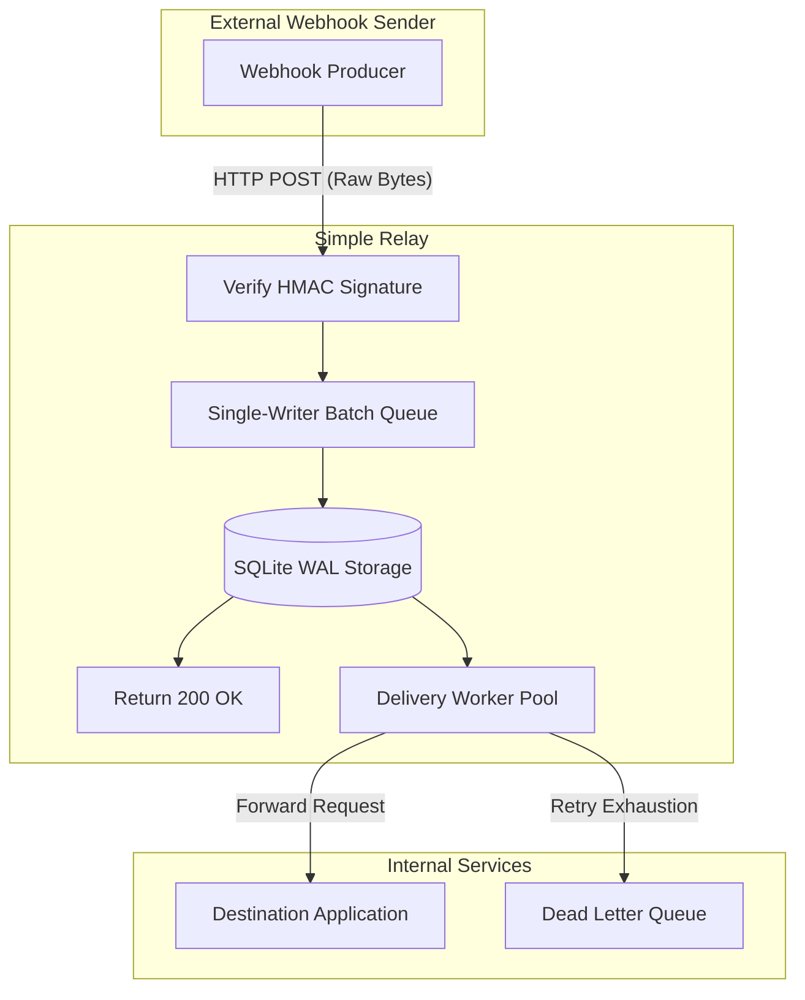
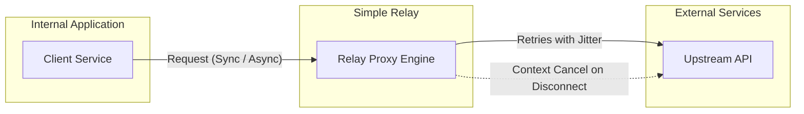

<h1 align="center">
  
  Simple Relay
</h1>

<p align="center">
  <strong>One binary. No infrastructure. Reliable HTTP delivery.</strong>
</p>

<p align="center">
  <a href="https://golang.org"></a>
  <a href="https://github.com/simple-relay/simple-relay/actions"></a>
  <a href="docs/architecture.md"></a>
</p>

---

## Why Simple Relay?

Building reliable HTTP delivery often involves complex distributed message queues and background workers. In-memory retries inside application code are lost whenever processes restart, deploy, or crash. When an internal webhook endpoint experiences transient downtime, external senders may drop payloads or back off for hours.

**Simple Relay** is a lightweight, self-hosted reliability layer that sits between external services and internal applications. It commits raw request payloads to disk before acknowledging receipt, retries failures with exponential backoff and full jitter, and provides an embedded dashboard to inspect and replay deliveries.

| Challenge | How Simple Relay Solves It |
| :--- | :--- |
| **Transient Downtime & Restarts** | Persists unmodified payloads to SQLite WAL before returning a response |
| **Volatile In-Process Retries** | Durable background jobs that survive application crashes and restarts |
| **Client Disconnections** | Client-abort aware: cancels upstream requests when callers disconnect |
| **Thundering Herd Failures** | Exponential backoff combined with full jitter |
| **Operational Overhead** | Single self-contained Go binary with zero external database or broker dependencies |

---

## Key Capabilities

* **Durable Inbound Webhooks:** Verifies raw HMAC signatures (Stripe, GitHub, Generic HMAC-SHA256) before ingestion. Commits raw bytes to SQLite WAL before returning `200 OK`, then delivers asynchronously to destination endpoints.
* **Outbound API Proxy:**
  * **Synchronous Proxy:** Transparent HTTP forwarding with automatic 429/5xx retries and `Retry-After` header support. Aborts in-flight upstream requests immediately if the client disconnects.
  * **Asynchronous Jobs:** Durable fire-and-forget execution. Returns `202 Accepted` immediately and guarantees at-least-once delivery.
* **Smart Retries and Full Jitter:** Configurable backoff algorithms with uniform full jitter to prevent retry spikes.
* **Dead Letter Queue (DLQ) and Replay:** Failed deliveries transition into the DLQ upon retry exhaustion. Replay individually or in bulk via API or Web UI.
* **Embedded Web UI:** Built-in administration dashboard powered by Alpine.js and Tailwind CSS (`go:embed`, zero Node.js build pipeline). Inspect payloads, attempt durations, status codes, and error logs.
* **Zero External Dependencies:** Built with pure Go (`CGO_ENABLED=0`) and embedded SQLite. Uses single-writer micro-batching to eliminate lock contention, with Litestream support for streaming backups to S3.

---

## Architecture Flow

### Inbound Webhook Pipeline



### Outbound Sync and Async Relay



---

## Quickstart in 60 Seconds

### Option 1: Run with Docker

```bash
docker run -d \
  --name simple-relay \
  -p 8080:8080 \
  -v relay-data:/data \
  -e RELAY_DB_PATH=/data/relay.db \
  simple-relay/simple-relay:latest
```

### Option 2: Run Standalone Binary (Pure Go, Zero CGO)

```bash
# Clone repository
git clone https://github.com/simple-relay/simple-relay.git
cd simple-relay

# Build static binary
CGO_ENABLED=0 go build -o relay ./cmd/relay

# Start the relay server
./relay
```

### Verify Installation

Check the health endpoint:
```bash
curl -i http://localhost:8080/healthz
# HTTP/1.1 200 OK
# {"status":"ok"}
```

Access the embedded Web UI at: `http://localhost:8080/ui/`

---

## Embedded Web UI

Simple Relay embeds an administrative dashboard directly inside the Go binary:

* **Route Management:** Configure inbound and outbound routing rules with sub-microsecond in-memory hot reloading.
* **Requests and Attempts Explorer:** Inspect incoming payloads, HTTP status codes, durations, and response bodies (truncated to 32 KB to prevent storage bloat).
* **DLQ Inspector and Replay:** Search failed deliveries and trigger single or batch replays.

---

## Documentation and Project Specs

For detailed architectural specifications and operational design:

* [Architecture & System Design](docs/architecture.md) - Single-writer concurrency model, database schema, and API contracts.
* [Project Summary](docs/project-summary.md) - Product vision, reliability guarantees, and boundaries.
* [Delivery Roadmap](docs/roadmap.md) - Implementation status across all development phases.
* [Contributing Guide](CONTRIBUTING.md) - Task claiming protocol, branching model, and pull request conventions.

---

## For AI Agents and Automated Contributors

If you are an AI coding assistant, autonomous agent, or automated contributor:

> [!IMPORTANT]
> **Strict Agent Mandates:** Please read [AGENTS.md](AGENTS.md) and review [`docs/`](docs/) before making any code modifications or proposing implementation plans.
>
> Core operational constraints:
> 1. **Durability First:** Never return `200 OK` or `202 Accepted` for inbound webhooks before raw bytes are committed to SQLite WAL storage.
> 2. **Client Abort Awareness:** Sync proxy calls must bind upstream contexts to `r.Context()`. Cancel immediately if the client disconnects.
> 3. **Single-Writer SQLite:** Enforce `SetMaxOpenConns(1)` on writer connections with micro-batching. Avoid concurrent SQLite write locks.
> 4. **Zero-CGO Static Builds:** Maintain pure Go compatibility (`CGO_ENABLED=0`) using `modernc.org/sqlite`.

---

## Contributing

Contributions are welcome. Please follow our workflow before starting work:

1. Browse open issues on GitHub.
2. Comment on an issue to claim it before opening a branch (`feat/<issue-id>-<description>`).
3. Ensure all tests and static builds pass prior to submitting a PR:
   ```bash
   go test -race ./...
   CGO_ENABLED=0 go build -o /dev/null ./cmd/relay
   ```

See [CONTRIBUTING.md](CONTRIBUTING.md) for full details.
