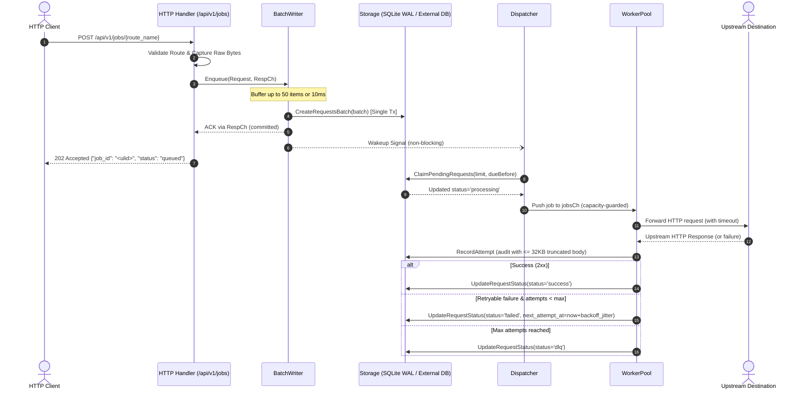

# Milestone 1.3 Design Spec: Asynchronous Outbound Durable Jobs & Background Delivery

- **Date:** 2026-10-08
- **Milestone:** Phase 1 — Milestone 1.3
- **Status:** Approved / Ready for Implementation
- **Target Components:**
  - `internal/storage/storage.go` (Interface extensions)
  - `internal/storage/sqlite/request_repo.go` (Atomic claiming & lease recovery)
  - `internal/engine/batch_writer.go` (Single-writer micro-batching engine)
  - `internal/engine/dispatcher.go` (Polling, instant wakeup, lease reaper)
  - `internal/engine/worker_pool.go` (Goroutine worker pool, retry with full jitter, DLQ state machine)
  - `internal/api/handler_jobs.go` (Job Ingestion `POST` and Inspection `GET` endpoints)

---

## 1. Overview & Goals

Milestone 1.3 equips **Simple HTTP Relay** with an asynchronous, durable execution pipeline. Instead of holding open client connections (like the sync proxy in Milestone 1.2), incoming HTTP requests are durably committed to database storage and acknowledged with `202 Accepted`. A background delivery engine picks up scheduled jobs, executes outbound HTTP requests with exponential backoff and full jitter, logs execution audits, and routes repeatedly failing jobs to the Dead Letter Queue (DLQ).

### Core Goals
1. **Durability Golden Rule:** Never acknowledge `202 Accepted` until raw payload bytes are durably committed to storage.
2. **High Throughput Micro-Batching:** Ingestion goroutines feed an in-memory queue; a single batch writer commits batches (up to 50 items or 10ms) in a single transaction.
3. **Decoupled Architecture & Multi-DB Readiness:** The delivery engine and API layer interact solely with abstract Go repository interfaces (`storage.RequestRepository`, `storage.AttemptRepository`). Dialect-specific SQL and transaction handling remain strictly isolated within storage adapters, preparing the codebase for centralized engines (MySQL, PostgreSQL) without touching engine logic.
4. **Durable Asynchronous Retry Lifecycle:** Failed requests release worker goroutines immediately and schedule subsequent attempts in the database via `next_attempt_at`.
5. **Orphaned Job Recovery (Lease Timeout):** Jobs stuck in `processing` state beyond a lease threshold (5 minutes) are automatically reclaimed to prevent lost jobs across crashes or stalls.

---

## 2. End-to-End Architecture & Data Flow



---

## 3. Storage Interface Decoupling & Multi-DB Readiness

To guarantee portability to centralized databases (MySQL, PostgreSQL) in future releases:
- Packages `internal/engine` and `internal/api` **MUST NOT** import `modernc.org/sqlite` or `internal/storage/sqlite`.
- All operations are expressed through abstract Go interfaces in `internal/storage/storage.go`.

### 3.1 Interface Extensions (`internal/storage/storage.go`)

```go
type RequestRepository interface {
    CreateRequest(ctx context.Context, req *model.Request) error
    CreateRequestsBatch(ctx context.Context, reqs []*model.Request) error
    GetRequestByID(ctx context.Context, id string) (*model.Request, error)
    ListPendingRequests(ctx context.Context, limit int, dueBefore time.Time) ([]*model.Request, error)
    UpdateRequestStatus(ctx context.Context, id string, status model.RequestStatus, attemptsCount int, nextAttemptAt *time.Time, lastError *string) error
    
    // Milestone 1.3 Additions:
    ClaimPendingRequests(ctx context.Context, limit int, dueBefore time.Time) ([]*model.Request, error)
    RecoverStuckRequests(ctx context.Context, stuckBefore time.Time) (int64, error)
}
```

### 3.2 SQLite Implementation Details (`internal/storage/sqlite/request_repo.go`)
- **`ClaimPendingRequests`**:
  Executes atomically on the writer connection:
  1. `SELECT ... FROM requests WHERE status IN ('pending', 'failed') AND next_attempt_at <= ? ORDER BY next_attempt_at ASC LIMIT ?`
  2. For matched IDs: `UPDATE requests SET status = 'processing', updated_at = ? WHERE id IN (...)`
  3. Returns scanned `[]*model.Request` records.
- **`RecoverStuckRequests`**:
  `UPDATE requests SET status = 'pending', updated_at = ? WHERE status = 'processing' AND updated_at <= ?`

---

## 4. Ingestion Pipeline Component Specifications

### 4.1 BatchWriter (`internal/engine/batch_writer.go`)

#### Configuration & Fields:
- `repo storage.RequestRepository`: Abstract repository dependency.
- `queue chan *ingestionItem`: Buffered channel (size: 1,000 items).
- `batchSize int`: Maximum items per batch (default: 50).
- `flushInterval time.Duration`: Maximum flush wait duration (default: 10ms).
- `wakeFn func()`: Non-blocking callback invoked after successful batch commit to trigger Dispatcher.

#### Ingestion Item:
```go
type ingestionItem struct {
    req   *model.Request
    errCh chan error
}
```

#### Enqueue Workflow:
1. `Enqueue(ctx, req)` attempts to push `*ingestionItem` into `queue`.
2. **Natural Backpressure:** If `queue` is full, caller blocks until space frees up or `ctx.Done()` triggers.
3. Upon enqueue, caller blocks on `select { case err := <-item.errCh: return err case <-ctx.Done(): return ctx.Err() }`.

#### Worker Event Loop:
- Maintains a slice `items []*ingestionItem` and `reqs []*model.Request`.
- Consumes from `queue` until `len(items) == batchSize` or `flushTimer` ticks.
- Flushes batch via `repo.CreateRequestsBatch(ctx, reqs)`.
- Dispatches commit result (`nil` or `error`) to all `item.errCh`.
- If committed successfully and `wakeFn != nil`, calls `wakeFn()`.
- **Graceful Shutdown (`Close()`):** Drains any remaining items from `queue`, executes a final flush, and closes worker goroutine cleanly.

### 4.2 HTTP Job Endpoints (`internal/api/handler_jobs.go`)

#### 1. Ingest Job: `POST /api/v1/jobs/{route_name}`
- Look up route in `RouteRegistry` by name. If not found, return `404 Not Found`.
- Read raw request body using `http.MaxBytesReader` (bounded by max body size limit).
- Filter hop-by-hop headers (`Connection`, `Keep-Alive`, `Proxy-Authenticate`, `Transfer-Encoding`, `Upgrade`).
- Preserve client headers, propagate or generate `X-Relay-Request-ID` (lowercase ULID), propagate `Idempotency-Key` or `X-Relay-Idempotency-Key`.
- Construct `model.Request`:
  - `ID`: ULID string.
  - `RouteID`: `route.ID`.
  - `Method`: Incoming HTTP method.
  - `URL`: `route.DestinationURL`.
  - `Headers`: Preserved headers map.
  - `Body`: Exact raw payload byte slice.
  - `Status`: `model.RequestStatusPending`.
  - `NextAttemptAt`: `time.Now().UTC()`.
- Submit to `batchWriter.Enqueue(r.Context(), req)`.
- If client context aborted / timed out: return `504 Gateway Timeout`.
- On success: return HTTP `202 Accepted` with JSON:
  ```json
  {
    "job_id": "01jb0x...",
    "status": "queued"
  }
  ```

#### 2. Inspect Job: `GET /api/v1/jobs/{job_id}`
- Validate ULID path parameter.
- Query request via `storage.GetRequestByID(ctx, jobID)`. If not found, return `404 Not Found`.
- Query attempt history via `storage.ListAttemptsByRequestID(ctx, jobID)`.
- Return HTTP `200 OK` with JSON representation:
  ```json
  {
    "id": "01jb0x...",
    "route_id": "...",
    "method": "POST",
    "url": "https://api.example.com/target",
    "status": "pending|processing|success|failed|dlq",
    "attempts_count": 2,
    "next_attempt_at": "2026-10-08T13:45:00Z",
    "last_error": "upstream timeout",
    "created_at": "2026-10-08T13:40:00Z",
    "updated_at": "2026-10-08T13:42:00Z",
    "attempts": [
      {
        "id": "01jb0y...",
        "attempt_number": 1,
        "response_status_code": 500,
        "duration_ms": 125,
        "error_message": "500 Internal Server Error",
        "executed_at": "2026-10-08T13:40:01Z"
      }
    ]
  }
  ```

---

## 5. Delivery Pipeline Component Specifications

### 5.1 Dispatcher (`internal/engine/dispatcher.go`)

#### Fields & Parameters:
- `repo storage.RequestRepository`: Abstract request repository.
- `jobsCh chan *model.Request`: Buffered channel shared with `WorkerPool` (size: `worker_count * 2`).
- `wakeCh chan struct{}`: Buffered channel (size: 1) for instant notification from `BatchWriter`.
- `pollInterval time.Duration`: Polling interval for scheduled retries (default: 500ms).
- `leaseTimeout time.Duration`: Maximum duration a job can stay in `processing` before recovery (default: 5 minutes).
- `leaseReapInterval time.Duration`: Interval to run lease recovery reaper (default: 1 minute).

#### Lifecycle & Event Loop:
1. **Startup Recovery:** Upon `Start()`, immediately calls `repo.RecoverStuckRequests(ctx, time.Now().UTC())` to reclaim any orphaned jobs from past process halts.
2. **Loop Triggers:**
   - `case <-d.wakeCh`: Instant wake up upon newly committed jobs.
   - `case <-d.pollTicker.C`: Periodic scheduled poll.
   - `case <-d.reapTicker.C`: Periodic check to reclaim stuck `processing` jobs.
3. **Capacity-Guarded Dispatching:**
   - Calculate available capacity: `avail := cap(jobsCh) - len(jobsCh)`.
   - If `avail <= 0`, skip querying database (protecting memory from unbound fetching when workers are saturated).
   - If `avail > 0`, query and atomically transition up to `avail` jobs via `repo.ClaimPendingRequests(ctx, avail, time.Now().UTC())`.
   - Push claimed requests onto `jobsCh`.

### 5.2 WorkerPool (`internal/engine/worker_pool.go`)

#### Parameters:
- `concurrency int`: Worker goroutines count (default: 20, configurable via `RELAY_WORKER_CONCURRENCY`).
- `jobsCh <-chan *model.Request`: Read-only channel fed by `Dispatcher`.
- `routes *RouteRegistry`: In-memory registry for $O(1)$ route lookup.
- `reqRepo storage.RequestRepository`: For updating request lifecycle states.
- `attemptRepo storage.AttemptRepository`: For recording attempt audit records.
- `retryEngine *RetryEngine`: Exponential backoff with Full Jitter calculator.
- `client *http.Client`: Pooled HTTP transport client.

#### Worker Execution Cycle per Job:
1. **Route Resolution:**
   - Lookup route by `req.RouteID`.
   - If route is missing, transition request to `model.RequestStatusDLQ` with error `"route not found or deleted"`.
2. **Timeout Calculation:**
   - Check `X-Relay-Timeout` in `req.Headers`. If valid integer, use as attempt timeout.
   - Otherwise, fall back to `route.TimeoutMS` (default: 10,000ms).
3. **HTTP Dispatch:**
   - Create outgoing `http.Request` with `req.Method`, `req.URL`, and `req.Body`.
   - Attach headers from `req.Headers`.
   - Measure execution start time.
   - Perform `client.Do(outReq)` with attempt context timeout.
4. **Audit Log Recording:**
   - Read response status code and response body.
   - Truncate response body to **32 KB** maximum using `model.TruncateResponseBody`.
   - Persist attempt record via `attemptRepo.RecordAttempt(...)`.
5. **State Transition & Retry Decision:**
   - **Success (status code < 400 or non-retryable success):**
     - Update status to `model.RequestStatusSuccess`, increment `attempts_count`, clear `next_attempt_at` and `last_error`.
   - **Failure (429, 5xx, network error, timeout):**
     - Increment `newAttempts := req.AttemptsCount + 1`.
     - If `newAttempts < route.MaxAttempts`:
       - Calculate backoff delay using `retryEngine.CalculateBackoff(newAttempts, retryAfterHeader)`.
       - Compute `nextAttemptAt = time.Now().UTC().Add(delay)`.
       - Update request status to `model.RequestStatusFailed`, set `next_attempt_at`, store `last_error`.
       - **Worker is freed immediately** to process other incoming jobs.
     - If `newAttempts >= route.MaxAttempts`:
       - Transition status to `model.RequestStatusDLQ`, set `next_attempt_at = nil`, store `last_error`.

---

## 6. Testing & Verification Plan

| Test Scope | Target File | Verification Criteria |
| :--- | :--- | :--- |
| **Storage Repository** | `internal/storage/sqlite/request_repo_test.go` | Verify `ClaimPendingRequests` fetches due records and marks them `processing` atomically. Verify `RecoverStuckRequests` resets old `processing` jobs. |
| **Batch Ingestion** | `internal/engine/batch_writer_test.go` | Verify grouping up to 50 items into 1 commit; verify 10ms timer flush; verify backpressure and context cancellation; verify clean shutdown drain. |
| **Dispatcher Loop** | `internal/engine/dispatcher_test.go` | Verify instant dispatch via `wakeCh`; verify capacity bounding prevents channel overflow; verify lease reaper recovers stalled jobs. |
| **Worker Delivery** | `internal/engine/worker_pool_test.go` | Verify 200 OK transitions to `success`; verify 500 triggers exponential backoff with jitter and `failed` status; verify `dlq` transition upon exceeding `max_attempts`; verify 32KB body truncation. |
| **Job APIs** | `internal/api/handler_jobs_test.go` | Verify `POST /api/v1/jobs/{route_name}` returns `202 Accepted` with valid ULID; verify `GET /api/v1/jobs/{job_id}` returns status and attempt history. |
| **Static Build & Race** | CLI commands | Run `go test -race ./...` (must pass 100%) and `CGO_ENABLED=0 go build -o /dev/null ./cmd/relay`. |
