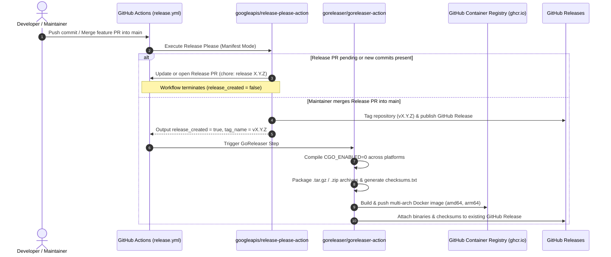

# Automated Versioning & Release Workflow — Technical Design Specification

> **Date:** 2026-10-10  
> **Status:** Approved  
> **Author:** pmlonng (<phanminlongg@gmail.com>)  
> **Target Milestone:** Phase 3 — Embedded Web UI & Lifecycle Maintenance  
> **Related Issues:** [#18](https://github.com/simple-relay/simple-relay/issues/18) (Multi-Platform Build Configuration), [#19](https://github.com/simple-relay/simple-relay/issues/19) (Automated Versioning & Release Workflow)  
> **Related Specs:** [2026-10-09-version-check-design.md](2026-10-09-version-check-design.md)  

---

## 1. Overview & Problem Statement

Simple HTTP Relay is designed as a single, self-hosted, zero-dependency binary. Currently, compiling cross-platform release artifacts, generating semantic version tags, maintaining `CHANGELOG.md`, and pushing multi-architecture container images are manual and error-prone tasks.

This specification unifies **Issue #18** (Multi-Platform Build Configuration with GoReleaser) and **Issue #19** (Automated Versioning & Release Workflow with Release Please) into a fully automated, hands-off CI/CD release pipeline.

### Core Objectives
1. **Automated SemVer Management & Changelog:** Leverage Google's `release-please` to inspect Conventional Commits on `main`, batch changes into pending Release PRs, and publish GitHub Releases on merge.
2. **Zero-CGO Multi-Platform Cross-Compilation:** Build static, stripped binaries for Linux (`amd64`, `arm64`), macOS (`amd64`, `arm64`), and Windows (`amd64`) via GoReleaser.
3. **Hardened Multi-Arch Docker Publishing:** Build and push `linux/amd64` and `linux/arm64` container images to GitHub Container Registry (GHCR) running as an unprivileged user (`nonroot`).
4. **Binary Version Injection:** Inject Git commit, version tag, and build timestamp into `internal/version` during compilation via `-ldflags`.
5. **Zero External Secrets:** Run the entire pipeline using GitHub Actions default `${{ secrets.GITHUB_TOKEN }}` without requiring external PATs or third-party registry tokens.

---

## 2. Architecture & Pipeline Workflow

### 2.1 Release Lifecycle Sequence



### 2.2 Operational Flow: Batching & Safe Releases
- Normal feature/fix PRs merged into `main` **never** trigger releases immediately.
- Release Please batches all Conventional Commits (`feat:`, `fix:`, `perf:`, `refactor:`, `chore:`) into a single pending Release PR (`chore(main): release X.Y.Z`).
- Maintainers maintain full release cadence control. Merging the Release PR is the sole trigger for publishing the GitHub release and compiling artifacts.

---

## 3. Configuration & Component Specifications

### 3.1 Release Please Configuration

#### `release-please-config.json`
Located at repository root:
```json
{
  "$schema": "https://raw.githubusercontent.com/googleapis/release-please/main/schemas/config.json",
  "packages": {
    ".": {
      "release-type": "go",
      "package-name": "simple-relay",
      "bump-minor-pre-major": true,
      "include-component-in-tag": false,
      "changelog-path": "CHANGELOG.md",
      "changelog-sections": [
        { "type": "feat", "section": "Features" },
        { "type": "fix", "section": "Bug Fixes" },
        { "type": "perf", "section": "Performance Improvements" },
        { "type": "refactor", "section": "Code Refactoring" },
        { "type": "docs", "section": "Documentation" },
        { "type": "chore", "section": "Maintenance & Dependencies" }
      ]
    }
  }
}
```

#### `.release-please-manifest.json`
Establishes the initial release baseline:
```json
{
  ".": "0.1.0"
}
```

### 3.2 GoReleaser Configuration (`.goreleaser.yaml`)
Utilizes GoReleaser v2 specification:
```yaml
version: 2

project_name: simple-relay

before:
  hooks:
    - go mod tidy

builds:
  - id: simple-relay
    main: ./cmd/relay
    binary: simple-relay
    env:
      - CGO_ENABLED=0
    flags:
      - -trimpath
    ldflags:
      - -s -w
      - -X github.com/simple-relay/simple-relay/internal/version.Version={{ .Version }}
      - -X github.com/simple-relay/simple-relay/internal/version.GitCommit={{ .Commit }}
      - -X github.com/simple-relay/simple-relay/internal/version.BuildDate={{ .Date }}
    goos:
      - linux
      - darwin
      - windows
    goarch:
      - amd64
      - arm64
    ignore:
      - goos: windows
        goarch: arm64

archives:
  - id: default
    format: tar.gz
    name_template: "{{ .ProjectName }}_{{ .Version }}_{{ .Os }}_{{ .Arch }}"
    format_overrides:
      - goos: windows
        format: zip
    files:
      - README.md
      - LICENSE*

checksum:
  name_template: "checksums.txt"
  algorithm: sha256

dockers:
  - image_templates:
      - "ghcr.io/{{ .Env.REPO_OWNER_LOWER }}/simple-relay:{{ .Version }}-amd64"
      - "ghcr.io/{{ .Env.REPO_OWNER_LOWER }}/simple-relay:latest-amd64"
    dockerfile: Dockerfile
    use: buildx
    build_flag_templates:
      - "--platform=linux/amd64"
      - "--label=org.opencontainers.image.title={{ .ProjectName }}"
      - "--label=org.opencontainers.image.version={{ .Version }}"
      - "--label=org.opencontainers.image.revision={{ .FullCommit }}"
    goos: linux
    goarch: amd64

  - image_templates:
      - "ghcr.io/{{ .Env.REPO_OWNER_LOWER }}/simple-relay:{{ .Version }}-arm64"
      - "ghcr.io/{{ .Env.REPO_OWNER_LOWER }}/simple-relay:latest-arm64"
    dockerfile: Dockerfile
    use: buildx
    build_flag_templates:
      - "--platform=linux/arm64"
      - "--label=org.opencontainers.image.title={{ .ProjectName }}"
      - "--label=org.opencontainers.image.version={{ .Version }}"
      - "--label=org.opencontainers.image.revision={{ .FullCommit }}"
    goos: linux
    goarch: arm64

docker_manifests:
  - name_template: "ghcr.io/{{ .Env.REPO_OWNER_LOWER }}/simple-relay:{{ .Version }}"
    image_templates:
      - "ghcr.io/{{ .Env.REPO_OWNER_LOWER }}/simple-relay:{{ .Version }}-amd64"
      - "ghcr.io/{{ .Env.REPO_OWNER_LOWER }}/simple-relay:{{ .Version }}-arm64"
  - name_template: "ghcr.io/{{ .Env.REPO_OWNER_LOWER }}/simple-relay:latest"
    image_templates:
      - "ghcr.io/{{ .Env.REPO_OWNER_LOWER }}/simple-relay:latest-amd64"
      - "ghcr.io/{{ .Env.REPO_OWNER_LOWER }}/simple-relay:latest-arm64"

release:
  mode: append
```

### 3.3 Hardened `Dockerfile`
Minimal Alpine runtime with explicit non-root user and root certificates:
```dockerfile
FROM alpine:3.20

RUN apk --no-cache add ca-certificates tzdata \
    && addgroup -S relay -g 10001 \
    && adduser -S relay -u 10001 -G relay

WORKDIR /app
COPY simple-relay /usr/local/bin/simple-relay

USER 10001:10001
EXPOSE 8080

ENTRYPOINT ["simple-relay"]
```

### 3.4 GitHub Workflow Definition (`.github/workflows/release.yml`)
```yaml
name: Release

on:
  push:
    branches:
      - main

concurrency:
  group: ${{ github.workflow }}-${{ github.ref }}
  cancel-in-progress: false

permissions:
  contents: write
  pull-requests: write
  packages: write

jobs:
  release:
    name: Release & Publish
    runs-on: ubuntu-latest
    steps:
      - name: Run Release Please
        id: release
        uses: googleapis/release-please-action@v4
        with:
          config-file: release-please-config.json
          manifest-file: .release-please-manifest.json

      - name: Checkout repository
        if: ${{ steps.release.outputs.release_created == 'true' }}
        uses: actions/checkout@v4
        with:
          fetch-depth: 0

      - name: Set up Go
        if: ${{ steps.release.outputs.release_created == 'true' }}
        uses: actions/setup-go@v5
        with:
          go-version-file: 'go.mod'
          cache: true

      - name: Compute Lowercase Repository Owner
        if: ${{ steps.release.outputs.release_created == 'true' }}
        id: repo
        env:
          OWNER: ${{ github.repository_owner }}
        run: echo "owner=$(echo "$OWNER" | tr '[:upper:]' '[:lower:]')" >> "$GITHUB_OUTPUT"

      - name: Set up QEMU
        if: ${{ steps.release.outputs.release_created == 'true' }}
        uses: docker/setup-qemu-action@v3

      - name: Set up Docker Buildx
        if: ${{ steps.release.outputs.release_created == 'true' }}
        uses: docker/setup-buildx-action@v3

      - name: Log in to GitHub Container Registry
        if: ${{ steps.release.outputs.release_created == 'true' }}
        uses: docker/login-action@v3
        with:
          registry: ghcr.io
          username: ${{ github.actor }}
          password: ${{ secrets.GITHUB_TOKEN }}

      - name: Run GoReleaser
        if: ${{ steps.release.outputs.release_created == 'true' }}
        uses: goreleaser/goreleaser-action@v6
        with:
          distribution: goreleaser
          version: latest
          args: release --clean
        env:
          GITHUB_TOKEN: ${{ secrets.GITHUB_TOKEN }}
          REPO_OWNER_LOWER: ${{ steps.repo.outputs.owner }}
```

### 3.5 In-App Version Metadata (`internal/version/version.go`)
```go
package version

// Injected at build time via -ldflags
var (
	Version   = "dev"
	GitCommit = "unknown"
	BuildDate = "unknown"
)

// UserAgent returns the standard User-Agent header string.
func UserAgent() string {
	return "simple-relay/" + Version
}
```

Integrated into `cmd/relay/main.go`:
```go
logger.Info("starting simple-relay",
	"version", version.Version,
	"commit", version.GitCommit,
	"build_date", version.BuildDate,
)
```

---

## 4. Security & Hardening Architecture

1. **PwnRequest / Untrusted PR Immunity:** The release workflow strictly listens only to `push: branches: [main]`. Forks and untrusted PRs never execute this workflow, eliminating write-token exfiltration hazards.
2. **Container Least Privilege (CIS Benchmark):** The container execution switches away from `root` (UID 0) to unprivileged `USER 10001:10001`.
3. **Reproducible & Sanitized Builds:** `-trimpath` removes absolute host paths from binaries; `-s -w` strips debug symbols.
4. **Static Binary Attack Surface Elimination:** `CGO_ENABLED=0` guarantees no shared library dynamic linking, immune to libc CVEs.
5. **No Long-Lived Secrets:** Utilizes the ephemeral, scoped `GITHUB_TOKEN` provided natively by GitHub Actions.

---

## 5. Verification & Testing Strategy

1. **Configuration Syntactic Integrity:**
   - Validate JSON: `jq empty release-please-config.json` and `jq empty .release-please-manifest.json`.
   - Validate YAML: Lint `.goreleaser.yaml` and `.github/workflows/release.yml`.
2. **Build & Ldflags Injection Verification:**
   - Execute `go build -ldflags="-X github.com/simple-relay/simple-relay/internal/version.Version=v0.1.0-test" -o /tmp/test-relay ./cmd/relay`.
   - Verify binary runs and outputs the injected version.
3. **Test Suite & Static Build Pass:**
   - `go test -v ./...`
   - `go test -race ./...`
   - `CGO_ENABLED=0 go build -trimpath -ldflags="-s -w" -o /dev/null ./cmd/relay`
