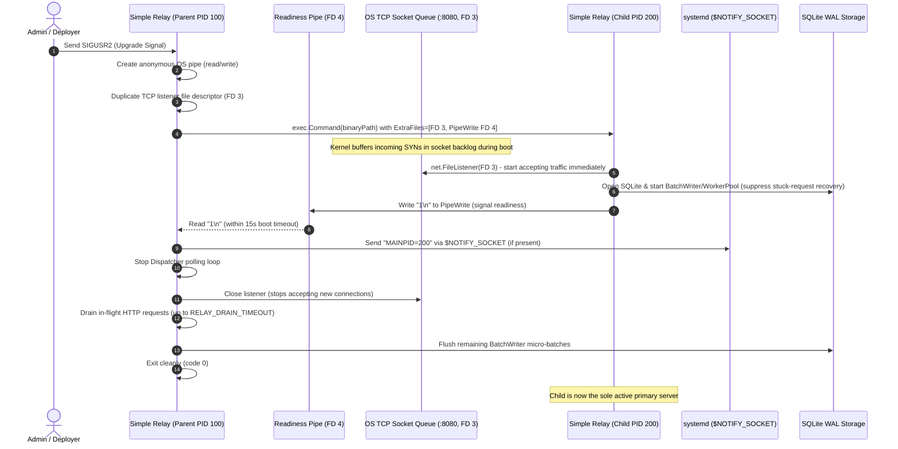

# Zero-Downtime Live Binary Upgrade & Socket Handoff — Technical Design Specification

> **Date:** 2026-10-12  
> **Status:** Approved  
> **Author:** pmlonng (<phanminlongg@gmail.com>)  
> **Target Milestone:** Phase 3 — Milestone 3.2: Lifecycle Maintenance & Zero-Downtime Operations  
> **Linked Issue:** [#51](https://github.com/simple-relay/simple-relay/issues/51)  
> **Related Epics:** SQLite Storage Engine, Standalone Single-Binary Deployment  

---

## 1. Overview & Problem Statement

Simple Relay operates under the core tagline: **"One binary. No infrastructure. Reliable HTTP delivery."**

In standalone single-host deployments (bare-metal Linux/macOS servers, systemd services, or standalone VMs), Simple Relay runs directly as a single binary `./relay`. Currently, upgrading or restarting the binary requires terminating the existing process (`SIGINT` or `SIGTERM`) and launching the new binary. 

### The Problem
During the restart window:
1. The listening TCP socket (`:8080`) is closed or unreachable.
2. Inbound webhook senders (Stripe, GitHub, Shopify) and internal clients encounter connection refused (`ECONNREFUSED`) or connection timeouts.
3. Upstream providers perceive the relay as down, triggering delayed exponential retry cycles that compromise real-time webhook ingestion.
4. Requiring an external reverse proxy (such as Nginx, HAProxy, or Envoy) solely for rolling restarts violates the "Zero Infrastructure" guarantee.

### The Solution
Implement native, zero-downtime live binary upgrades within Simple Relay via **Socket Inheritance, File Descriptor Handoff, and Full Process Teardown (Option A)**:
* The running process receives a trigger signal (`SIGUSR2` on POSIX systems).
* The parent process duplicates its active listening socket and creates an anonymous readiness pipe.
* The parent spawns the new binary, passing the listening socket (FD 3) and readiness pipe write end (FD 4) via `cmd.ExtraFiles`.
* The child process adopts the listening socket, performs fast startup, begins accepting incoming connections immediately, and signals readiness by writing `1\n` to the readiness pipe.
* The parent process detects readiness, stops accepting new connections, notifies systemd of the new `MAINPID` (if running under systemd with `$NOTIFY_SOCKET`), pauses its dispatcher, drains in-flight requests and background batch commits within a timeout, and terminates cleanly (`exit 0`).

---

## 2. Goals, Non-Goals, and Anti-Goals

### Goals
- **Zero Dropped Connections:** Guarantee zero `ECONNREFUSED` or dropped TCP connections during binary upgrades under continuous HTTP traffic.
- **Pure Go Standard Library Implementation:** Zero external heavy CGO dependencies; use Go `net.FileListener`, `os/exec`, and standard POSIX sockets.
- **Safe Dispatcher & Storage Handover:** Coordinate SQLite WAL writers and background delivery dispatchers between parent and child processes to eliminate duplicate job executions and `SQLITE_BUSY` deadlock cascades.
- **Fail-Safe Rollback:** If the new binary crashes during boot or times out without signalling readiness (default 15s timeout), the parent detects the failure, keeps the original socket active, resumes full operations, and continues serving traffic uninterrupted.
- **Systemd Compatibility:** Support Linux systemd process tracking via `sd_notify` (`MAINPID=<child_pid>`) so systemd does not terminate the unit when the parent exits.
- **Cross-Platform Compilation:** Native zero-downtime support on POSIX (Linux and macOS / Darwin). Clean fallback compilation for Windows via Go build tags (`//go:build !windows` vs `//go:build windows`).

### Non-Goals
- **Database Schema Migrations During Live Upgrade (Deferred):** Modifying schema DDL on live boot is explicitly deferred out of scope for this task to preserve database stability and simplicity.
- **Replacing Orchestrators:** When deployed across distributed container clusters (e.g., AWS ECS, Kubernetes), rolling restarts are handled by the load balancer and orchestrator via standard `SIGTERM` graceful shutdown.
- **Windows Live Socket Handoff:** Windows does not support POSIX socket inheritance or `SIGUSR2`. Windows builds will gracefully fall back to standard graceful shutdown.

### Anti-Goals
- **No Supervisor Parent Resident Overhead:** The parent process does not remain in memory after draining. It terminates cleanly to prevent memory bloat and zombie process management.

---

## 3. High-Level Architecture & Workflow



---

## 4. Detailed Component Design

### 4.1 Listener & Environment Protocol (`internal/upgrade/listener.go`)

Handles socket acquisition on startup:

```go
package upgrade

import (
    "fmt"
    "net"
    "os"
    "strconv"
)

const (
    EnvInheritFD = "RELAY_INHERIT_FD"
    EnvReadyFD   = "RELAY_READY_FD"
    EnvParentPID = "RELAY_PARENT_PID"
)

// GetListener returns an inherited net.Listener if passed by parent,
// or binds a new TCP listener on the specified address.
func GetListener(addr string) (net.Listener, bool, error) {
    fdStr := os.Getenv(EnvInheritFD)
    if fdStr == "" {
        ln, err := net.Listen("tcp", addr)
        return ln, false, err
    }

    fd, err := strconv.Atoi(fdStr)
    if err != nil {
        return nil, false, fmt.Errorf("invalid %s value: %w", EnvInheritFD, err)
    }

    // In Go, files in ExtraFiles are assigned descriptors starting from 3.
    file := os.NewFile(uintptr(fd), "inherited-listener")
    if file == nil {
        return nil, false, fmt.Errorf("failed to open inherited file descriptor %d", fd)
    }
    defer file.Close()

    ln, err := net.FileListener(file)
    if err != nil {
        return nil, false, fmt.Errorf("failed to create listener from file descriptor: %w", err)
    }

    return ln, true, nil
}

// SignalReady notifies the parent process via the readiness pipe that the child is up and serving.
func SignalReady() error {
    readyFDStr := os.Getenv(EnvReadyFD)
    if readyFDStr == "" {
        return nil // Not an inherited child process
    }
    fd, err := strconv.Atoi(readyFDStr)
    if err != nil {
        return err
    }
    pipe := os.NewFile(uintptr(fd), "readiness-pipe")
    if pipe == nil {
        return fmt.Errorf("invalid readiness pipe file descriptor %d", fd)
    }
    defer pipe.Close()

    _, err = pipe.Write([]byte("1\n"))
    return err
}
```

### 4.2 Upgrade Manager & Process Handoff (`internal/upgrade/manager_posix.go`)

POSIX implementation (Linux and macOS):

1. **Signal Listener:** Traps `syscall.SIGUSR2`.
2. **Binary Resolution:** Resolves the binary executable:
   * First check `RELAY_UPGRADE_BINARY` env var.
   * Then fallback to `exec.LookPath(os.Args[0])`.
   * Then fallback to `os.Executable()`.
3. **Pipe & Socket Preparation:**
   * Extracts listener file descriptor: `listener.(*net.TCPListener).File()`.
   * Creates anonymous pipe via `os.Pipe()`.
   * Sets `cmd.ExtraFiles = []*os.File{listenerFile, pipeWriter}`.
   * Sets environment variables: `RELAY_INHERIT_FD=3`, `RELAY_READY_FD=4`, `RELAY_PARENT_PID=<pid>`.
4. **Child Launch & Readiness Wait:**
   * Launches child process: `cmd.Start()`.
   * Closes child's `pipeWriter` in parent.
   * Blocks on `pipeReader.Read()` with a 15-second timeout (`RELAY_UPGRADE_TIMEOUT`).
   * If child exits or times out: parent logs error, closes pipe, and resumes normal server operation without downtime.
5. **Handoff & Graceful Teardown:**
   * Once readiness byte `"1"` is received:
     * If `$NOTIFY_SOCKET` exists, sends `MAINPID=<child.Process.Pid>` to systemd.
     * Parent calls `dispatcher.Stop()` (stops claiming new delivery jobs).
     * Parent closes its listener and calls `srv.Shutdown(ctx)` with `RELAY_DRAIN_TIMEOUT` (default: 30s).
     * Parent flushes `batchWriter.Close()` and exits with code 0.

### 4.3 Windows Fallback (`internal/upgrade/manager_windows.go`)

On Windows (`//go:build windows`):
* `GetListener` always calls `net.Listen("tcp", addr)`.
* `SignalReady` is a no-op.
* Signal listener only listens for `os.Interrupt` and `syscall.SIGTERM`.
* Attempts to trigger live upgrades log: `"live zero-downtime upgrades via socket handoff are not supported on Windows; please restart the service."`
* Ensures `CGO_ENABLED=0 go build` succeeds cleanly across all platforms.

### 4.4 Engine Coordination & Safe Dispatching

* **SQLite WAL Concurrency:** WAL mode supports concurrent readers and serialized writers across processes. Both parent and child write using busy timeouts.
* **Dispatcher De-duplication:**
  * When child starts with `RELAY_INHERIT_FD`, it **suppresses** immediate `RecoverStuckRequests(time.Now())` so it does not hijack jobs currently being dispatched by parent workers.
  * Parent stops its Dispatcher immediately when the readiness signal is received.
  * Child begins polling for new pending jobs.

---

## 5. Configuration & Environment Variables

| Variable | Default | Description |
|----------|---------|-------------|
| `RELAY_DRAIN_TIMEOUT` | `30s` | Maximum time parent waits for active requests to finish after handoff. |
| `RELAY_UPGRADE_TIMEOUT` | `15s` | Maximum time parent waits for child to signal readiness before aborting upgrade. |
| `RELAY_UPGRADE_BINARY` | `""` | Optional explicit path to the new binary executable to spawn. |

---

## 6. Verification & Testing Strategy

1. **Unit Tests:**
   * Test `upgrade.GetListener` in cold boot vs simulated FD inheritance.
   * Test readiness pipe handshake and timeout cancellation.
2. **Integration Test — Zero-Downtime Reload under Traffic (Linux & macOS):**
   * Start relay binary on an ephemeral port.
   * Launch background worker pool sending 100 requests/sec.
   * Send `SIGUSR2` to trigger live upgrade.
   * Assert 100% requests succeed (0 connection refused, 0 timeouts).
   * Assert child takes over socket, parent terminates cleanly with exit code 0.
3. **Build Matrix Verification:**
   * Static compilation check: `CGO_ENABLED=0 GOOS=linux go build ./cmd/relay`
   * Darwin compilation check: `CGO_ENABLED=0 GOOS=darwin go build ./cmd/relay`
   * Windows compilation check: `CGO_ENABLED=0 GOOS=windows go build ./cmd/relay`
