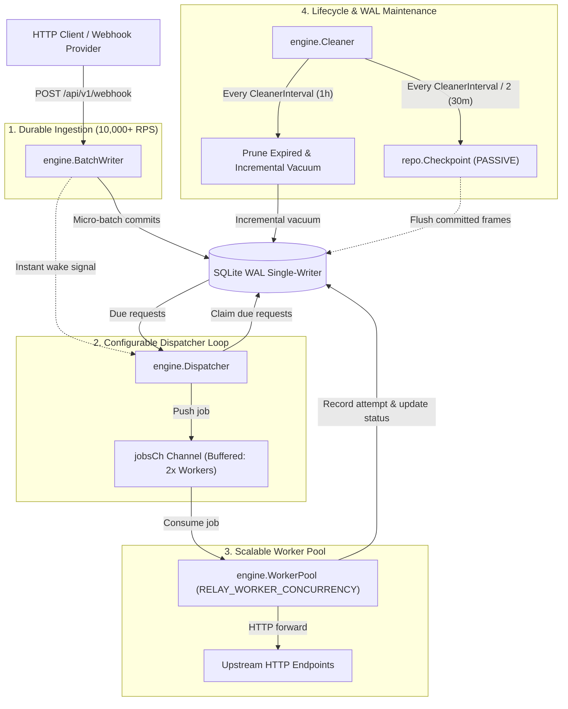

# Configurable Dispatcher Concurrency & Active WAL Checkpointing — Technical Design Specification

> **Date:** 2026-10-13  
> **Status:** Draft (Ready for Review)  
> **Author:** pmlonng (<phanminlongg@gmail.com>)  
> **Target Phase:** Phase 3 — Embedded Web UI & Lifecycle Maintenance  
> **Linked Issue:** [#47](https://github.com/simple-relay/simple-relay/issues/47)  
> **Related Epics:** SQLite Storage Engine, High-Throughput Delivery Pipeline, Adapter Pattern  

---

## 1. Overview & Problem Statement

Simple Relay guarantees the **Durability Golden Rule**: an inbound webhook is never acknowledged with HTTP `200 OK` or `202 Accepted` until its raw byte payload is committed to SQLite WAL storage.

During performance benchmarking of Simple Relay v0.3.0 ([`docs/benchmarks.md`](../benchmarks.md)), an asymmetry between inbound webhook ingestion and outbound delivery throughput was identified:

* **Inbound Ingestion Throughput:** Sustained **10,058 req/s** with durable SQLite WAL commits at ~5.6ms median latency under 100 concurrent clients.
* **Outbound Delivery Throughput:** Capped at **~111 events/second** when relaying queued jobs to upstream HTTP destinations.

### Root Cause Analysis

Investigation revealed three hardcoded bottlenecks in the pipeline:
1. **Hardcoded Worker Pool Concurrency:** In `internal/engine/worker_pool.go`, worker concurrency defaulted to a hardcoded 20 workers. Furthermore, in `cmd/relay/main.go`, `WorkerPoolConfig{}` was instantiated with zero-values, ignoring any configured pool size.
2. **Hardcoded Channel Buffer Capacity:** In `cmd/relay/main.go`, the job distribution channel `jobsCh` was hardcoded to `make(chan *model.Request, 40)`.
3. **Hardcoded Polling Fallback:** In `internal/engine/dispatcher.go`, fallback polling interval was hardcoded to 500ms without CLI or configuration exposure.
4. **Unbounded SQLite WAL Growth Under Bursts:** Under sustained bursts of tens of thousands of webhooks in seconds, the SQLite WAL file (`relay.db-wal`) grew to over 50MB. Because SQLite's default auto-checkpointing only runs when writers are idle and no active readers hold open snapshots, WAL frames accumulated without being transferred to the main database file. Furthermore, the storage retention cleaner only executed `PRAGMA incremental_vacuum` after pruning expired records, lacking any active WAL checkpointing routine.

### Workload Characteristics & Sizing Model

Unlike process-based background queues (such as Python Celery, where each worker is an OS process consuming 50–100MB of RAM and heavy CPU context switching), Simple Relay workers are **Go goroutines** (~2KB stack memory) executing **I/O-bound network requests** (`http.Client.Do`). 

Because outbound delivery spends over 95% of its execution time awaiting network round-trips and upstream HTTP responses:
$$\text{Delivery Throughput (RPS)} = \frac{\text{Worker Concurrency}}{\text{Average Upstream Latency (seconds)}}$$

For example, with an upstream response latency of 100ms (0.1s):
* 20 workers achieve a maximum drain rate of $\approx 200 \text{ req/s}$ (benchmark observed ~111 req/s with SQLite claiming overhead).
* 100 workers achieve a drain rate of $\approx 1,000 \text{ req/s}$.

Operators handling high-volume webhook forwarding require runtime controls to scale outbound throughput while keeping resource usage lean and SQLite WAL growth strictly bounded.

---

## 2. Goals, Non-Goals, and Anti-Goals

### Goals
- **Configurable Outbound Concurrency:** Expose `-workers` CLI flag and `RELAY_WORKER_CONCURRENCY` environment variable (default: 20).
- **Dynamic Auto-Scaling Dispatcher Buffer:** Automatically size the dispatcher channel buffer `jobsCh` to $2 \times \text{WorkerConcurrency}$ when not explicitly configured, while allowing manual tuning via `-dispatcher-buffer` / `RELAY_DISPATCHER_BUFFER`.
- **Configurable Dispatcher Poll Interval:** Expose `-dispatcher-poll-ms` CLI flag and `RELAY_DISPATCHER_POLL_MS` environment variable (default: 500ms).
- **Storage Adapter Architecture Compliance:** Add `Checkpoint(ctx context.Context) error` to `storage.RetentionRepository` in `internal/storage/storage.go`. Encapsulate SQLite-specific `PRAGMA wal_checkpoint(PASSIVE);` inside `internal/storage/sqlite/retention_repo.go`, ensuring zero leakage into engine abstractions and no-op compatibility for future PostgreSQL and MySQL storage adapters.
- **Gentle, Non-Blocking Active WAL Checkpointing:** Execute non-blocking WAL checkpoints (`PASSIVE`) to prevent lock contention (`SQLITE_BUSY`) against active readers or the single-writer `BatchWriter`.
- **Zero-Config Periodic Checkpointing:** Schedule periodic checkpoints inside `Cleaner` at $\frac{1}{2} \times \text{CleanerInterval}$ (default: 30 minutes for a 1-hour cleaner interval) with zero extra environment variables or flags, plus execute during `CleanOnce`.
- **Configuration Hygiene:** Remove legacy `RELAY_WORKER_POOL_SIZE` without backward-compatibility clutter prior to v1.0 production release.

### Non-Goals
- **Blocking or Truncating Checkpoints:** Do not use `PRAGMA wal_checkpoint(TRUNCATE)` or `RESTART`, which block concurrent readers and can introduce table lock timeouts under continuous ingestion.
- **Complex WAL File-Size Daemons:** Do not implement file stat monitors or threshold-polling disk loops. Checkpointing at half the cleaner interval provides bounded WAL sizes with zero operational complexity.
- **Modifying SQLite Single-Writer Model:** Preserve strict single-writer connection isolation (`SetMaxOpenConns(1)`) and micro-batch commit architecture.

### Anti-Goals
- **No Leaking SQLite Dialects into Engine:** Engine components (`Cleaner`, `Dispatcher`, `WorkerPool`) must never execute raw SQLite PRAGMA strings or dialect-specific logic directly.

---

## 3. System Architecture & Workflow

### 3.1 End-to-End Delivery Pipeline Flow



---

## 4. Detailed Component Design

### 4.1 Configuration Layer (`internal/config/config.go`)

Update `Config` to replace `WorkerPoolSize` with clean, unified configuration fields:

```go
type Config struct {
    Host                 string
    Port                 int
    DBPath               string
    LogLevel             string
    WorkerConcurrency    int           // CLI: -workers, ENV: RELAY_WORKER_CONCURRENCY (default: 20)
    DispatcherBuffer     int           // CLI: -dispatcher-buffer, ENV: RELAY_DISPATCHER_BUFFER (default: dynamic 2x WorkerConcurrency)
    DispatcherPollMS     int           // CLI: -dispatcher-poll-ms, ENV: RELAY_DISPATCHER_POLL_MS (default: 500)
    RetentionSuccessDays int
    RetentionFailedDays  int
    CleanerInterval      time.Duration
    AdminPassword        string
    MaxBatchSize         int
    BatchTimeoutMS       int
    DrainTimeout         time.Duration
}
```

#### Default Sizing & Dynamic Calculation

In `DefaultConfig()` and `loadFromEnv()`:
```go
func DefaultConfig() *Config {
    return &Config{
        Host:                 "0.0.0.0",
        Port:                 8080,
        DBPath:               "relay.db",
        LogLevel:             "info",
        WorkerConcurrency:    20,
        DispatcherBuffer:     0, // 0 signifies dynamic auto-sizing: 2 * WorkerConcurrency
        DispatcherPollMS:     500,
        RetentionSuccessDays: 7,
        RetentionFailedDays:  30,
        CleanerInterval:      1 * time.Hour,
        AdminPassword:        "",
        MaxBatchSize:         50,
        BatchTimeoutMS:       10,
        DrainTimeout:         30 * time.Second,
    }
}
```

In `Validate()`:
```go
func (c *Config) Validate() error {
    // ... existing validations ...
    if c.WorkerConcurrency < 1 {
        return fmt.Errorf("worker concurrency must be >= 1")
    }
    if c.DispatcherPollMS <= 0 {
        return fmt.Errorf("dispatcher poll interval must be > 0 ms")
    }
    // Dynamic buffer resolution
    if c.DispatcherBuffer <= 0 {
        c.DispatcherBuffer = c.WorkerConcurrency * 2
    }
    return nil
}
```

CLI flag registration in `config.Load()`:
```go
fs.IntVar(&cfg.WorkerConcurrency, "workers", cfg.WorkerConcurrency, "Outbound worker pool concurrency")
fs.IntVar(&cfg.DispatcherBuffer, "dispatcher-buffer", cfg.DispatcherBuffer, "Dispatcher jobs channel buffer capacity (0 for 2x workers)")
fs.IntVar(&cfg.DispatcherPollMS, "dispatcher-poll-ms", cfg.DispatcherPollMS, "Dispatcher polling interval in milliseconds")
```

Environment variable parsing in `c.loadFromEnv()`:
```go
if val := os.Getenv("RELAY_WORKER_CONCURRENCY"); val != "" {
    if w, err := strconv.Atoi(val); err == nil && w > 0 {
        c.WorkerConcurrency = w
    }
}
if val := os.Getenv("RELAY_DISPATCHER_BUFFER"); val != "" {
    if b, err := strconv.Atoi(val); err == nil && b > 0 {
        c.DispatcherBuffer = b
    }
}
if val := os.Getenv("RELAY_DISPATCHER_POLL_MS"); val != "" {
    if p, err := strconv.Atoi(val); err == nil && p > 0 {
        c.DispatcherPollMS = p
    }
}
```

---

### 4.2 Storage Adapter Interface & SQLite Implementation

#### 1. Interface Definition (`internal/storage/storage.go`)

Extend `RetentionRepository`:

```go
type RetentionRepository interface {
    PruneExpiredRequests(ctx context.Context, successCutoff, failedCutoff time.Time, batchSize int) (int64, error)
    ReclaimStorage(ctx context.Context, maxPages int) error

    // Checkpoint executes database-specific write-ahead log synchronization.
    // In SQLite, this executes PRAGMA wal_checkpoint(PASSIVE).
    // In PostgreSQL / MySQL, this is a no-op (WAL is managed by the DB daemon).
    Checkpoint(ctx context.Context) error
}
```

#### 2. SQLite Adapter Implementation (`internal/storage/sqlite/retention_repo.go`)

```go
// Checkpoint executes PRAGMA wal_checkpoint(PASSIVE) on SQLite writer pool.
// PASSIVE mode checkpoints as many frames as possible without waiting for readers or writers,
// completely eliminating SQLITE_BUSY lock contention.
func (r *RetentionRepo) Checkpoint(ctx context.Context) error {
    query := "PRAGMA wal_checkpoint(PASSIVE);"
    if _, err := r.db.Writer().ExecContext(ctx, query); err != nil {
        return fmt.Errorf("failed to execute sqlite wal checkpoint: %w", err)
    }
    return nil
}
```

---

### 4.3 Engine Integration

#### 1. Cleaner Background Routine (`internal/engine/cleaner.go`)

Add a checkpoint loop running at `Interval / 2`:

```go
func (c *Cleaner) run(ctx context.Context) {
    defer c.wg.Done()

    // Initial cleanup pass on startup
    if _, err := c.CleanOnce(ctx); err != nil && !errors.Is(err, context.Canceled) {
        c.logger.Error("initial storage retention cleanup failed", "error", err)
    }

    cleanTicker := time.NewTicker(c.cfg.Interval)
    defer cleanTicker.Stop()

    checkpointInterval := c.cfg.Interval / 2
    if checkpointInterval < 10*time.Second {
        checkpointInterval = 10 * time.Second
    }
    checkpointTicker := time.NewTicker(checkpointInterval)
    defer checkpointTicker.Stop()

    for {
        select {
        case <-cleanTicker.C:
            if _, err := c.CleanOnce(ctx); err != nil && !errors.Is(err, context.Canceled) {
                c.logger.Error("periodic storage retention cleanup failed", "error", err)
            }
        case <-checkpointTicker.C:
            if err := c.repo.Checkpoint(ctx); err != nil && !errors.Is(err, context.Canceled) {
                c.logger.Warn("periodic wal checkpoint failed", "error", err)
            } else {
                c.logger.Debug("periodic wal checkpoint executed successfully")
            }
        case <-ctx.Done():
            return
        case <-c.done:
            return
        }
    }
}
```

And in `CleanOnce(ctx)`:
```go
func (c *Cleaner) CleanOnce(ctx context.Context) (CleanResult, error) {
    // ... existing prune and reclaim logic ...
    
    // Always execute WAL checkpoint during full maintenance pass
    if err := c.repo.Checkpoint(ctx); err != nil {
        c.logger.Warn("wal checkpoint failed during maintenance pass", "error", err)
    }

    return result, nil
}
```

#### 2. Service Wiring (`cmd/relay/main.go`)

Wire dynamic configurations into the async pipeline:

```go
// Initialize asynchronous durable delivery pipeline
jobsCh := make(chan *model.Request, cfg.DispatcherBuffer)
dispatcher := engine.NewDispatcher(db.RequestRepo, jobsCh, engine.DispatcherConfig{
    PollInterval:          time.Duration(cfg.DispatcherPollMS) * time.Millisecond,
    SkipImmediateRecovery: inherited,
})
workerPool := engine.NewWorkerPool(jobsCh, registry, db.RequestRepo, db.AttemptRepo, retryEngine, engine.WorkerPoolConfig{
    Concurrency: cfg.WorkerConcurrency,
})
```

---

## 5. Capacity Sizing & Performance Tuning Guide

The following table serves as an operational reference for sizing `RELAY_WORKER_CONCURRENCY` and `RELAY_DISPATCHER_BUFFER`:

| Target Upstream Drain Rate | Avg Upstream Latency | Recommended `-workers` | Dynamic `jobsCh` Buffer | Estimated Memory (Goroutines) |
| :--- | :--- | :--- | :--- | :--- |
| **~100 req/s** | 100 ms | **20** (default) | 40 | ~40 KB |
| **~500 req/s** | 100 ms | **50** | 100 | ~100 KB |
| **~1,000 req/s** | 100 ms | **100** | 200 | ~200 KB |
| **~2,000 req/s** | 50 ms | **100** | 200 | ~200 KB |
| **~2,000 req/s** | 150 ms | **300** | 600 | ~600 KB |

### Key Takeaway for Operators
Because Go goroutines require only ~2KB of initial stack space, scaling `-workers` from 20 to 200 adds less than **0.5 MiB** of total memory usage to Simple Relay. CPU utilization remains negligible because workers spend virtually all time blocked in kernel socket poll (`epoll_wait` / `kqueue`).

---

## 6. Verification & Testing Strategy

### 6.1 Unit & Integration Tests
1. **Configuration Validation Suite (`internal/config/config_test.go`):**
   - Test default resolution: `WorkerConcurrency == 20`, `DispatcherBuffer == 40`, `DispatcherPollMS == 500`.
   - Test CLI flag overrides: `-workers 50 -dispatcher-buffer 120 -dispatcher-poll-ms 250`.
   - Test environment variable overrides: `RELAY_WORKER_CONCURRENCY`, `RELAY_DISPATCHER_BUFFER`, `RELAY_DISPATCHER_POLL_MS`.
   - Test validation errors: negative/zero concurrency, negative poll intervals.
   - Verify dynamic auto-sizing: when `DispatcherBuffer == 0`, validator resolves to `2 * WorkerConcurrency`.
2. **SQLite Retention & Checkpoint Suite (`internal/storage/sqlite/retention_repo_test.go`):**
   - Test `Checkpoint(ctx)` successfully executes `PRAGMA wal_checkpoint(PASSIVE)` on an active SQLite database.
   - Verify zero errors and non-blocking operation while concurrent read queries are in flight.
3. **Cleaner Ticker Test (`internal/engine/cleaner_test.go`):**
   - Verify checkpoint mock is called on `Interval / 2` ticker and during `CleanOnce`.
4. **Dispatcher & WorkerPool Wiring Test (`cmd/relay/main_test.go` or engine tests):**
   - Verify that custom concurrency and channel capacities correctly process and deliver requests end-to-end.

### 6.2 Regression & Quality Commands
Every phase must pass all required verification checks:
```bash
# 1. Run all unit and integration tests
go test -v ./...

# 2. Run with race detector enabled
go test -race ./...

# 3. Verify static zero-CGO binary build
CGO_ENABLED=0 go build -o /dev/null ./cmd/relay
```

---

## 7. Implementation Checklist

- [ ] Update `internal/config/config.go` with `WorkerConcurrency`, `DispatcherBuffer`, `DispatcherPollMS` (remove `WorkerPoolSize`).
- [ ] Add CLI flags and ENV loaders for all new fields with validation.
- [ ] Update `internal/config/config_test.go` to test defaults, overrides, dynamic buffer resolution, and edge cases.
- [ ] Add `Checkpoint(ctx context.Context) error` to `storage.RetentionRepository` in `internal/storage/storage.go`.
- [ ] Implement `Checkpoint` in `internal/storage/sqlite/retention_repo.go`.
- [ ] Add unit test for `Checkpoint` in `internal/storage/sqlite/retention_repo_test.go`.
- [ ] Update `internal/engine/cleaner.go` to schedule checkpointing at `Interval / 2` and call in `CleanOnce`.
- [ ] Update `internal/engine/cleaner_test.go` to cover checkpoint invocations.
- [ ] Wire `cfg.WorkerConcurrency`, `cfg.DispatcherBuffer`, and `cfg.DispatcherPollMS` in `cmd/relay/main.go`.
- [ ] Run full test suites (`go test -race ./...`) and static build verification (`CGO_ENABLED=0 go build`).
- [ ] Update roadmap item [#47](https://github.com/simple-relay/simple-relay/issues/47) in `docs/roadmap.md`.
