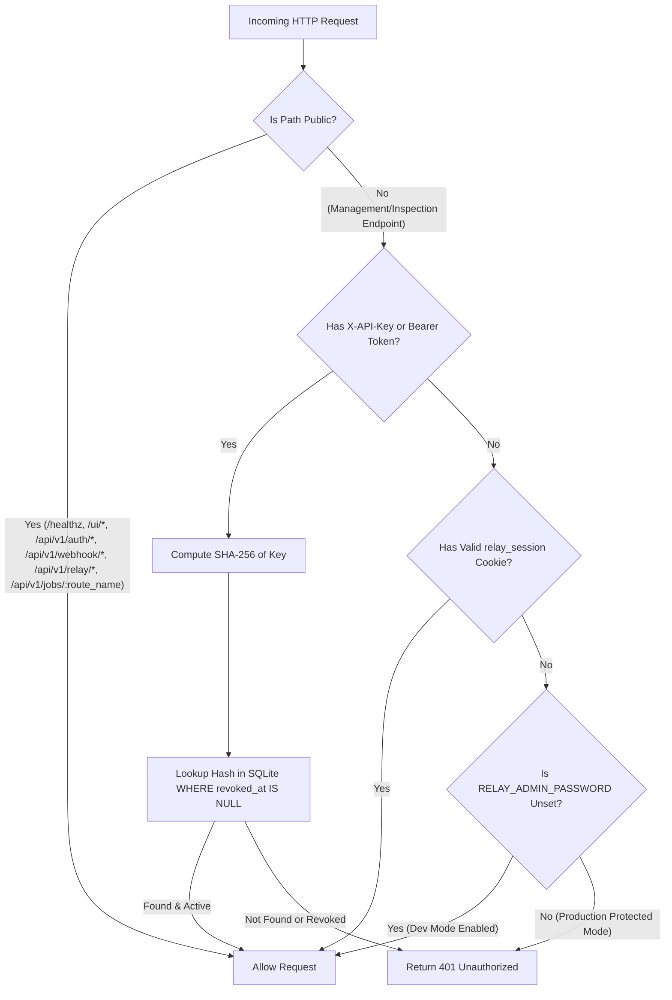

# API Key Authentication for Programmatic Management Design Specification

- **Target Issue:** [#23](https://github.com/simple-relay/simple-relay/issues/23) (Roadmap Phase 4)
- **Prerequisite PR:** [#50](https://github.com/simple-relay/simple-relay/pull/50) (Admin Password Session Auth & Login Rate Limiter)
- **Related Issue & PR:** [#21](https://github.com/simple-relay/simple-relay/issues/21), [#62](https://github.com/simple-relay/simple-relay/pull/62) (CLI Inspection Binary `cmd/relay-cli`)
- **Author:** `pmlonng`
- **Date:** 2026-10-15
- **Status:** Approved for Implementation Planning

---

## 1. Intent & Context

### 1.1 The "Why"
Simple Relay provides reliable HTTP webhook ingestion, asynchronous job retries, and synchronous relay proxying. Administrative operations (managing routes, inspecting request payloads and attempt history, dumping job details, and triggering DLQ re-deliveries) require protection against unauthorized access in production deployments.

While PR #50 introduces browser cookie-based session authentication for the Web UI (authenticated against `RELAY_ADMIN_PASSWORD`), machine-to-machine integrations (e.g., CI/CD pipelines, automated recovery scripts, and the `relay-cli` binary in #21 / #62) cannot rely on ambient browser cookies or interactive HTML login forms.

API Key Authentication provides durable, revocable cryptographic tokens allowing headless CLI tools and automated services to securely manage routes, query telemetry, and trigger operational workflows.

---

## 2. Goals, Non-Goals & Anti-Goals

### 2.1 Goals
- **Durable SQLite Storage:** Persist API key metadata and revoked status inside the primary SQLite database using pure-Go driver (`modernc.org/sqlite`).
- **One-Way Cryptographic Hashing:** Never store raw API keys in SQLite. Store strictly one-way SHA-256 hashes (`key_hash`).
- **Masked Key Representation:** Store a human-readable hint field `masked_key` in format `AAA*****BBBB` (e.g., `sr_live_9f83*****a3b1`) allowing operators to identify keys in lists without credential exposure.
- **Harmonized Dual Authentication Pipeline:** Integrate cleanly with PR #50:
  - When `RELAY_ADMIN_PASSWORD` is unset (`""`): Dev mode is active. Management endpoints remain open, allowing local development, testing, and zero-config Web UI / `relay-cli` usage.
  - When `RELAY_ADMIN_PASSWORD` is configured: Authentication is strictly enforced on all administrative endpoints. Access is granted if the request carries **either** a valid API key (`X-API-Key: <key>` or `Authorization: Bearer <key>`) **or** an active admin session cookie (`relay_session`).
  - If credentials are provided (API key header or session cookie), they are always validated for correctness regardless of dev mode.
- **Cold Boot Auto-Seeding:** If the database contains zero API keys (`COUNT(*) == 0`) on initial startup, automatically generate a default key named `default`, log its raw token once to server logs (`slog.Info`), and persist its hash and masked representation to SQLite.
- **API Key Management Endpoints:** Provide REST APIs to generate new keys (`POST /api/v1/api-keys`), list keys (`GET /api/v1/api-keys`), and revoke keys (`DELETE /api/v1/api-keys/{id}`). Raw tokens are returned **only once** upon creation.
- **Comprehensive Endpoint Protection:** Enforce authentication across all administrative and inspection endpoints:
  - `/api/v1/routes` (GET, POST, PUT, DELETE)
  - `/api/v1/requests` (GET list, GET :id)
  - `/api/v1/jobs/{job_id}` (GET inspection - *resolves Critical finding #1 in PR #50 review*)
  - `/api/v1/dlq` (GET list, POST replay, POST replay-all)
  - `/api/v1/api-keys` (GET list, POST create, DELETE revoke)
- **Standardized Error Format:** Return HTTP `401 Unauthorized` with JSON payload `{"error": "Unauthorized: API key or admin session required"}` when credentials are missing, invalid, or revoked under protected mode.
- **Zero-CGO Static Binary Compatibility:** Strict adherence to `CGO_ENABLED=0 go build`.

### 2.2 Non-Goals
- **Web UI Management in this PR:** UI screens for API key generation and management will be implemented in a dedicated follow-up PR.
- **Reversible Encryption & Master Secrets:** No AES-256-GCM symmetric encryption or `RELAY_SECRET_KEY` required; one-way hashing provides superior security and operational simplicity for authentication tokens.
- **Granular RBAC / Per-Key Scopes:** All valid API keys hold full administrative permissions. Fine-grained permission trees are out of scope for Simple Relay.
- **Protecting Data Ingress Routes:** Public-facing traffic endpoints remain unauthenticated by API key:
  - Inbound webhooks (`/api/v1/webhook/{route_name}`) rely on provider cryptographic signatures (HMAC).
  - Outbound sync relay (`/api/v1/relay/{route_name}`) and async job ingestion (`/api/v1/jobs/{route_name}`) remain public ingress points.

### 2.3 Anti-Goals
- **Plaintext Key Leakage:** Raw keys must never appear in database tables, subsequent GET responses, or error logs.
- **Timing Attack Vulnerabilities:** Comparisons of token hashes must use constant-time operations (`crypto/subtle.ConstantTimeCompare`).
- **Resurrecting Revoked Keys on Reboot:** Boot auto-seeding must check total rows (`COUNT(*) == 0`), never active rows. If an admin intentionally revokes all keys, restarting the server must not resurrect an active default key.

---

## 3. Database Schema & Storage Layer

### 3.1 DDL Schema (`api_keys`)

```sql
CREATE TABLE IF NOT EXISTS api_keys (
    id TEXT PRIMARY KEY,                       -- Monotonic lowercase ULID
    name TEXT NOT NULL,                        -- Human descriptive identifier (e.g., "ci-cd-bot", "default")
    key_hash TEXT NOT NULL UNIQUE,             -- Hex-encoded SHA-256 hash (64 characters)
    masked_key TEXT NOT NULL,                  -- Format: AAA*****BBBB (e.g., "sr_live_9f83*****a3b1")
    created_at DATETIME NOT NULL DEFAULT CURRENT_TIMESTAMP,
    revoked_at DATETIME NULL                   -- NULL indicates active; timestamp indicates revoked
);

CREATE INDEX IF NOT EXISTS idx_api_keys_lookup ON api_keys(key_hash) WHERE revoked_at IS NULL;
```

### 3.2 Storage Interface (`internal/storage/storage.go`)

```go
type APIKeyRepository interface {
    CreateAPIKey(ctx context.Context, key *model.APIKey) error
    GetAPIKeyByHash(ctx context.Context, keyHash string) (*model.APIKey, error)
    ListAPIKeys(ctx context.Context) ([]*model.APIKey, error)
    RevokeAPIKey(ctx context.Context, id string) error
    CountTotalKeys(ctx context.Context) (int64, error)
    CountActiveKeys(ctx context.Context) (int64, error)
}
```

### 3.3 Domain Model (`internal/model/api_key.go`)

```go
type APIKey struct {
    ID        string     `json:"id"`
    Name      string     `json:"name"`
    KeyHash   string     `json:"-"`
    MaskedKey string     `json:"masked_key"`
    CreatedAt time.Time  `json:"created_at"`
    RevokedAt *time.Time `json:"revoked_at,omitempty"`
}

// CreateKeyResponse is returned exclusively upon key creation to reveal the raw token once.
type CreateKeyResponse struct {
    ID        string    `json:"id"`
    Name      string    `json:"name"`
    Key       string    `json:"key"` // Raw token revealed once
    MaskedKey string    `json:"masked_key"`
    CreatedAt time.Time `json:"created_at"`
}
```

### 3.4 Key Generator Helper (`internal/api/key_generator.go`)

Raw keys are generated with prefix `sr_live_` followed by 32 cryptographically secure random bytes (hex-encoded, 64 characters total payload):
1. `rawKey = "sr_live_" + hex.EncodeToString(randomBytes32)`
2. `keyHash = hex(sha256(rawKey))`
3. `maskedKey = rawKey[:11] + "*****" + rawKey[len(rawKey)-4:]` (e.g., `sr_live_3f9*****8c21`)

---

## 4. Authentication Pipeline & Middleware Architecture

### 4.1 Evaluation Matrix

When a client hits an endpoint:



### 4.2 Protected Endpoints Map
- `GET, POST, PUT, DELETE /api/v1/routes`
- `GET, POST, PUT, DELETE /api/v1/routes/{id}`
- `GET /api/v1/requests`
- `GET /api/v1/requests/{id}`
- `GET /api/v1/jobs/{job_id}` *(Resolves Critical finding #1 in PR #50 review)*
- `GET /api/v1/dlq`
- `POST /api/v1/dlq/{request_id}/replay`
- `POST /api/v1/dlq/replay-all`
- `GET, POST /api/v1/api-keys`
- `DELETE /api/v1/api-keys/{id}`

### 4.3 Public Endpoints Map
- `GET /healthz`
- `GET /`, `GET /ui`, `GET /ui/static/*`
- `GET /api/v1/auth/status`
- `POST /api/v1/auth/login`
- `POST /api/v1/auth/logout`
- `POST /api/v1/webhook/{route_name}` (Protected by HMAC signature verifiers)
- `POST /api/v1/relay/{route_name}` (Outbound sync relay data-path)
- `POST /api/v1/jobs/{route_name}` (Outbound async job ingestion data-path)

### 4.4 Behavior of `/api/v1/auth/status`
- `auth_required`: returns `cfg.AdminPassword != ""` (aligns with Web UI login requirements).
- `authenticated`: returns `true` if a valid `relay_session` cookie is present **or** a valid `X-API-Key` / `Bearer` token header is present.

---

## 5. REST API Specifications

### 5.1 Create API Key
- **Endpoint:** `POST /api/v1/api-keys`
- **Request Body:**
  ```json
  {
    "name": "ci-deployer"
  }
  ```
- **Response (`201 Created`):**
  ```json
  {
    "id": "01j8v3x4m89a0b1c2d3e4f5g6h",
    "name": "ci-deployer",
    "key": "sr_live_a8f9c2d1e0b3471928374655bcdea12039485761a2b3c4d5e6f7a8b9c0d1e2f3",
    "masked_key": "sr_live_a8f*****e2f3",
    "created_at": "2026-10-15T04:55:00Z"
  }
  ```

### 5.2 List API Keys
- **Endpoint:** `GET /api/v1/api-keys`
- **Response (`200 OK`):**
  ```json
  [
    {
      "id": "01j8v3x4m89a0b1c2d3e4f5g6h",
      "name": "default",
      "masked_key": "sr_live_7c1*****01b9",
      "created_at": "2026-10-15T04:00:00Z",
      "revoked_at": null
    },
    {
      "id": "01j8v3x4m89a0b1c2d3e4f5g6j",
      "name": "old-cli-key",
      "masked_key": "sr_live_99d*****33fa",
      "created_at": "2026-10-14T10:00:00Z",
      "revoked_at": "2026-10-15T03:30:00Z"
    }
  ]
  ```

### 5.3 Revoke API Key
- **Endpoint:** `DELETE /api/v1/api-keys/{id}`
- **Response (`200 OK`):**
  ```json
  {
    "id": "01j8v3x4m89a0b1c2d3e4f5g6h",
    "status": "revoked",
    "revoked_at": "2026-10-15T04:58:00Z"
  }
  ```

---

## 6. Cold Boot Auto-Seeding Lifecycle

During daemon initialization in `cmd/relay/main.go`:
1. SQLite connection pool and DDL migrations are initialized.
2. The server queries `APIKeyRepo.CountTotalKeys(ctx)`.
3. If `total == 0`:
   - System calls `GenerateRawKey("default")`.
   - Inserts record into `api_keys`.
   - Prints log banner:
     ```
     2026/10/15 05:00:00 INFO no API keys found; generated default bootstrap key name=default key=sr_live_... masked=sr_live_...
     ```
   - This ensures immediate headless usability by `relay-cli` without manual database manipulation or deadlocks.
4. If `total > 0`:
   - Seeding is skipped, preserving intentional key revocations across container or process restarts.

---

## 7. Verification & Testing Strategy

1. **Unit Testing (`internal/storage/sqlite/api_key_repo_test.go`):**
   - Verify CRUD operations: `CreateAPIKey`, `GetAPIKeyByHash`, `ListAPIKeys`, `RevokeAPIKey`.
   - Verify unique constraint on `key_hash`.
   - Verify `revoked_at` filtering in index and lookup query.
   - Verify `CountTotalKeys` vs `CountActiveKeys`.
2. **Middleware & Routing Testing (`internal/api/auth_test.go`):**
   - Test authentication via `X-API-Key`.
   - Test authentication via `Authorization: Bearer <key>`.
   - Test dual authentication with session cookie from PR #50.
   - Verify rejection of revoked keys with HTTP 401.
   - Verify strict protection of `GET /api/v1/jobs/{job_id}`.
   - Verify unauthenticated access allowed in Dev Mode (`RELAY_ADMIN_PASSWORD == ""`).
   - Verify public endpoints remain accessible without auth headers.
3. **End-to-End CLI Interoperability Testing:**
   - Execute `relay-cli` commands (`health`, `queue`, `dlq list`) with `--api-key` pointing to active key under protected mode.
   - Verify rejection with exit code 1 / `ErrUnauthorized` when invalid key is provided.
   - Verify `relay-cli` executes cleanly without `--api-key` in Dev Mode.
4. **Standard Verification Matrix:**
   - `go test -v ./...`
   - `go test -race ./...`
   - `CGO_ENABLED=0 go build -o /dev/null ./cmd/relay`
   - `CGO_ENABLED=0 go build -o /dev/null ./cmd/relay-cli`

---

## 8. Rollout & Dependency Gate

- **Step 1:** Wait for PR [#50](https://github.com/simple-relay/simple-relay/pull/50) to address code review feedback, pass CI, and merge into `main`.
- **Step 2:** Branch off latest `main` with `pmlonng/feat-23-api-key-auth`.
- **Step 3:** Implement SQLite schema, repository, model, key generator, middleware harmonization, and REST handlers.
- **Step 4:** Execute full test verification and open Pull Request linking `Fixes #23`.
