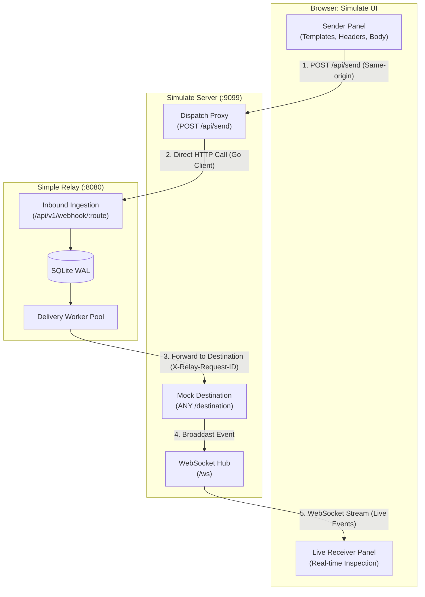

# E2E Webhook & Relay Simulation Tool (`scripts/simulator`) Design Specification

- **Target Issue:** [#69](https://github.com/simple-relay/simple-relay/issues/69)
- **Author:** `pmlonng`
- **Date:** 2026-10-16
- **Status:** Approved for Implementation

---

## 1. Intent & Context

### 1.1 The "Why"
Simple Relay functions as a self-hosted HTTP reliability layer handling both inbound webhooks and outbound proxying/jobs. To date, validating end-to-end delivery, HMAC verification, retry loops with backoff/jitter, and Dead Letter Queue (DLQ) state transitions has relied either on automated Go unit/integration tests or manually wiring up third-party services (such as Stripe CLI, GitHub webhooks, or external echo services like webhook.site).

This presents three key friction points:
1. **Manual Testing Overhead:** Developers and operators cannot quickly reproduce real-world provider behaviors (e.g., Stripe webhooks with valid or invalid timestamps/signatures, upstream services returning `500 Internal Server Error` or `429 Too Many Requests` with `Retry-After`) without maintaining external scaffolding.
2. **UI/UX Evaluation Blindspots:** Exploring and polishing the Simple Relay embedded Web UI (`/`) requires dynamic, realistic traffic flowing through the system in real time so operators can observe attempt tables, retry countdowns, and DLQ inspection states.
3. **Decoupled Verification:** There is currently no unified local tool that simultaneously acts as the inbound traffic generator (HTTP sender) and the internal destination endpoint (mock upstream receiver), while presenting both sides in a unified interface.

The **E2E Simulation Tool** (`scripts/simulator`) is an independent, zero-dependency developer tool designed to bridge this gap. It provides an embedded Web UI and local mock HTTP server that simulates webhook senders, receives relayed requests from Simple Relay, and streams delivery events to the operator for immediate visual auditing.

---

## 2. Goals, Non-Goals & Anti-Goals

### 2.1 Goals
- **Self-Contained Executable Tool:** A single Go script/program located in `scripts/simulator/` runnable with `go run ./scripts/simulator` or compiled as a standalone binary without external runtime dependencies.
- **Embedded Web UI (Simulate UI):** Embedded single-page interface using Alpine.js and Tailwind CSS (via CDN), consistent with Simple Relay's zero-build pipeline philosophy.
- **Dual-Role Architecture:**
  1. **HTTP Dispatch Proxy & Sender:** The simulator Go backend provides a local proxy endpoint (`POST /api/send`), called by the browser UI via standard same-origin `fetch`. The simulator backend executes the outgoing HTTP request directly to Simple Relay. This completely avoids browser CORS preflight restrictions (`OPTIONS`) without requiring any CORS middleware on the core Simple Relay daemon.
  2. **Mock Destination Server:** Lightweight HTTP server running locally (e.g., `http://localhost:9099/destination`) that receives forwarded requests from Simple Relay, logs incoming requests in memory, and broadcasts them live to the UI via WebSocket (`/ws`).
- **Flexible Authentication & Payload Presets:**
  - Support full customization of HTTP methods, URL query parameters (e.g., `?token=secret123&env=sandbox`), custom headers (e.g., `X-Api-Key: secret`), and raw request bodies.
  - Automatic dynamic HMAC calculation: For provider templates (Stripe, GitHub), the simulator UI/backend accepts a configurable signing secret (defaulting to a standard test secret `whsec_test_secret123`) and dynamically generates valid timestamps and HMAC-SHA256 signatures upon dispatch, enabling immediate end-to-end verification without manual cryptographic calculation.
  - Quick-fill templates for:
    - Stripe webhook (dynamic `Stripe-Signature: t={timestamp},v1={hmac}`).
    - GitHub webhook (dynamic `X-Hub-Signature-256: sha256={hmac}`).
    - Query-parameter authentication (testing inbound route validation rules with tokens/query params).
    - Custom header-based authentication (testing inbound route validation rules with `X-Api-Key` or `Authorization`).
    - Generic JSON webhook payload.
- **Controllable Destination Upstream Behavior:**
  - Allow the operator to configure the mock destination server's response status code (`200 OK`, `500 Internal Server Error`, `429 Too Many Requests` with `Retry-After: 3`) and artificial latency (ms) directly from the Simulate UI without restarting the tool.
  - Enables instantaneous triggering and real-time observation of Simple Relay's retry engine and DLQ transitions.
- **Side-by-Side Visual Auditing:**
  - Visual presentation displaying what was sent (Sender panel) alongside what was actually delivered by Simple Relay to the mock destination (Receiver stream).
  - Clear inspection of relayed headers (especially `X-Relay-Request-ID`, forwarded authentication headers, and idempotency keys) and raw body fidelity.
- **Stateless & In-Memory:** Zero database requirements. Received events are maintained in a bounded in-memory ring buffer (e.g., last 100 events) with a one-click "Clear Events" control.

### 2.2 Non-Goals
- **No Simple Relay Daemon Changes:** The simulator operates 100% externally. Zero modifications to `cmd/relay`, `internal/api`, or `internal/storage` are required.
- **No Persistent Database:** The simulator intentionally avoids persistent SQLite, Postgres, or disk storage. It is an ephemeral developer testing and UX exploration tool.
- **No Automated Relay API Polling:** The tool does not query Simple Relay's `/api/v1/jobs/{id}` or database. Verification is visual and operator-driven.
- **No Complex Diff Algorithms:** The UI does not perform semantic schema diffing or colored line-by-line diffing. Raw request and response details are displayed cleanly for direct human inspection.

### 2.3 Anti-Goals
- **No Heavy Framework Dependencies:** Avoid Node.js, npm build tooling, or third-party web frameworks. Use Go's standard library `net/http` and an embedded HTML/JS template.
- **No Tight Coupling with Simple Relay Internals:** The tool must interact solely over standard HTTP and WebSocket protocols as any external client and destination server would.

---

## 3. System Architecture & Component Design

### 3.1 High-Level Architecture Flow



### 3.2 Design Decision: Dispatch Proxy (`POST /api/send`) vs. Direct Browser Fetch
- **Architectural Call:** Simple Relay runs on port `:8080` without open CORS headers. If the browser on `:9099` issued direct `fetch()` calls with custom headers (`Stripe-Signature`, `X-Api-Key`), the browser would issue CORS preflight `OPTIONS` calls that Simple Relay would reject with `405 Method Not Allowed`.
- **Solution:** The Simulate UI sends a JSON payload to its own Go backend at `POST /api/send`. The Go backend makes the HTTP request to Simple Relay via standard Go `http.Client`, captures the status code, headers, latency, and response body, and returns it to the UI. This provides 100% CORS isolation with zero modifications to Simple Relay.

### 3.3 Workflow Execution Sequence

1. **Setup Route in Simple Relay:** The operator configures an inbound route in Simple Relay (via Web UI at `http://localhost:8080` or API) with destination URL pointing to the simulator's mock endpoint: `http://localhost:9099/destination`.
2. **Prepare Request (Sender Panel):**
   - Operator opens Simulate UI (`http://localhost:9099`).
   - Selects a quick-fill template (e.g., "Stripe Webhook", "GitHub Webhook", or "Query-Param Auth").
   - Can optionally edit the signing secret or target URL query params.
3. **Dispatch:**
   - Operator clicks "Send Request".
   - Browser calls `POST /api/send` on the simulator server.
   - The simulator backend (optionally computing HMAC signatures if requested) forwards the HTTP request to Simple Relay.
   - The UI immediately displays Simple Relay's ACK response (`200 OK` or `202 Accepted` with `relay_id` / `job_id`) and round-trip latency.
4. **Relay & Receive:**
   - Simple Relay validates signatures/query-rules, commits raw body to WAL, and worker pool delivers the payload to `http://localhost:9099/destination`.
   - The simulator's mock destination endpoint receives the relayed request, logs method, path, query params, headers (including `X-Relay-Request-ID`), and raw body.
   - Responds to Simple Relay with the configured mock status code (`200 OK`, `500`, or `429`).
5. **Real-Time UI Update:**
   - The simulator server serializes the received event as JSON and pushes it across active WebSocket connections (`/ws`).
   - The Simulate UI appends the event to the Live Receiver list in real time, allowing direct visual inspection.

### 3.4 Inbound Query Parameters vs Forwarded Destination URL
- Simple Relay evaluates query parameters on incoming webhooks (e.g. `/api/v1/webhook/route?token=secret`) strictly to satisfy route validation rules at the ingestion gate.
- When Simple Relay forwards the request, it dispatches to `route.DestinationURL`.
- The simulator supports testing this by:
  1. Allowing query parameters on the target URL to ensure Simple Relay accepts the request under configured query validation rules.
  2. Inspecting any query parameters received at `/destination` if `route.DestinationURL` was configured with them.

---

## 4. API & Protocol Specifications

### 4.1 Server Endpoints (`scripts/simulator`)

The simulator server listens on a configurable port (`default: 9099`, flag: `-port`).

| Endpoint | Method | Description |
| :--- | :--- | :--- |
| `/` | `GET` | Serves the embedded HTML/JS Simulate UI. |
| `/destination` | `ANY` | Mock destination endpoint receiving forwarded requests from Simple Relay. Captures full request data and broadcasts to WebSocket clients. |
| `/ws` | `GET` | WebSocket upgrade endpoint streaming received request events to the browser UI. |
| `/api/send` | `POST` | Proxy dispatch endpoint executing HTTP requests from the UI to Simple Relay. |
| `/api/mock-config` | `GET`, `POST` | Reads or updates mock server response behavior (`status_code`, `delay_ms`). |
| `/api/events` | `GET`, `DELETE` | Retrieves buffered in-memory events as JSON, or clears the buffer. |

### 4.2 Dispatch Proxy Request (`POST /api/send`)

#### Request
```json
{
  "url": "http://localhost:8080/api/v1/webhook/stripe-test",
  "method": "POST",
  "headers": {
    "Content-Type": "application/json"
  },
  "body": "{\"id\":\"evt_test\",\"type\":\"payment_intent.succeeded\"}",
  "sign_provider": "stripe",
  "sign_secret": "whsec_test_secret123"
}
```

#### Response (`200 OK`)
```json
{
  "status_code": 200,
  "headers": {
    "Content-Type": "application/json"
  },
  "body": "{\"relay_id\":\"01j9z5k7w4...\",\"status\":\"persisted\"}",
  "duration_ms": 3.8
}
```

### 4.3 Mock Response Configuration (`/api/mock-config`)

#### Request (`POST /api/mock-config`)
```json
{
  "status_code": 429,
  "delay_ms": 100,
  "headers": {
    "Retry-After": "3"
  }
}
```

#### Response (`200 OK`)
```json
{
  "status_code": 429,
  "delay_ms": 100,
  "headers": {
    "Retry-After": "3"
  }
}
```

### 4.4 WebSocket Event Schema (`/ws`)

When Simple Relay forwards a request to `/destination`, the simulator captures and broadcasts the following event payload over WebSocket:

```json
{
  "id": "evt_01j9z5k8...",
  "received_at": "2026-10-16T14:30:15.123Z",
  "method": "POST",
  "path": "/destination",
  "query_params": {
    "token": "secret123",
    "env": "sandbox"
  },
  "headers": {
    "Content-Type": "application/json",
    "X-Relay-Request-Id": "01j9z5k7w4...",
    "Stripe-Signature": "t=1729089015,v1=9a8b7c...",
    "User-Agent": "SimpleRelay/1.0"
  },
  "body": "{\"id\":\"evt_test\",\"type\":\"payment_intent.succeeded\",\"amount\":2000}",
  "response_status_returned": 200,
  "response_delay_ms": 0
}
```

---

## 5. Simulate UI Layout & Wireframe

The UI uses a responsive two-column layout designed with Tailwind CSS and Alpine.js.

```text
+----------------------------------------------------------------------------------------------------+
|  Simple Relay — E2E Traffic & Webhook Simulator                        ● WebSocket: Connected       |
+--------------------------------------------------+-------------------------------------------------+
| SENDER PANEL                                     | RECEIVER PANEL (Live Destination Stream)        |
|                                                  |                                                 |
| Preset Template:                                 | Mock Upstream Settings:                         |
| [ Stripe Webhook                  v ] [ Fill ]   | Return Status: [ 200 OK v ]   Delay: [ 0ms   ]  |
|                                                  |                                                 |
| Signing Secret (for HMAC):                       | [ Clear Events ]   Buffered: 12 events          |
| [ whsec_test_secret123                         ] | ----------------------------------------------- |
|                                                  | Recent Received Deliveries:                     |
| Target URL:                                      |                                                 |
| [ http://localhost:8080/api/v1/webhook/stripe?v=1 ] | ▼ [2026-10-16 14:30:15] POST /destination (200) |
|                                                  |   Relay ID: 01j9z5k7w4...                       |
| Method: [ POST v ]                               |   Query: ?token=secret123&env=sandbox           |
|                                                  |   Headers:                                      |
| Headers (Key: Value):                            |     X-Relay-Request-Id: 01j9z5k7w4...         |
| +----------------------------------------------+ |     Stripe-Signature: t=1729089015,v1=...     |
| | Content-Type: application/json               | |   Body:                                         |
| +----------------------------------------------+ |   {"id":"evt_test","type":"payment_intent..."}  |
|                                                  | ----------------------------------------------- |
| Request Body (Raw):                              | ▼ [2026-10-16 14:30:12] POST /destination (500) |
| +----------------------------------------------+ |   Relay ID: 01j9z5k5a1... (Retry Attempt #1)  |
| | {                                            | |   Mock returned: 500 Internal Server Error    |
| |   "id": "evt_test",                          | +-------------------------------------------------+
| |   "amount": 2000                             | |
| | }                                            | |
| +----------------------------------------------+ |
|                                                  |
| [ Send Request ]                                 |
|                                                  |
| Last Sent Result:                                |
| Status: 200 OK | Relay ID: 01j9z5k7w4... | 3.2ms |
+--------------------------------------------------+
```

### 5.1 Template Specifications

The simulator provides built-in pre-populated templates:

1. **Stripe Webhook:**
   - Path: `http://localhost:8080/api/v1/webhook/stripe-test`
   - Signing Provider: `stripe` (computes `t={time},v1={hmac_sha256}`)
   - Default Secret: `whsec_test_secret123`
   - Body: Standard Stripe `payment_intent.succeeded` event JSON.
2. **GitHub Webhook:**
   - Path: `http://localhost:8080/api/v1/webhook/github-test`
   - Signing Provider: `github` (computes `sha256={hmac_sha256}` into `X-Hub-Signature-256`)
   - Default Secret: `github_test_secret123`
   - Body: GitHub `push` event JSON with repository and commit metadata.
3. **Query Parameter Authentication:**
   - Path: `http://localhost:8080/api/v1/webhook/query-auth-test?token=webhook_secret_key_abc123&region=us-east`
   - Headers: `Content-Type: application/json`
   - Body: JSON payload to verify query param acceptance under route validation.
4. **Header Authentication (Custom Key / Bearer):**
   - Path: `http://localhost:8080/api/v1/webhook/header-auth-test`
   - Headers: `Content-Type: application/json`, `X-Api-Key: relay_secret_key_xyz987`
   - Body: JSON payload to verify custom authentication header acceptance.
5. **Generic Outbound Relay / Job:**
   - Path: `http://localhost:8080/api/v1/jobs/external-api`
   - Headers: `Content-Type: application/json`, `Idempotency-Key: idemp_12345`
   - Body: Target payload to test asynchronous durable job forwarding.

---

## 6. Implementation Architecture & File Layout

All simulator logic is isolated within `scripts/simulator/`:

```text
scripts/simulator/
├── main.go            # Entry point, flag parsing (-port, -relay-url), HTTP & WebSocket server
├── dispatch.go        # HTTP proxy client and dynamic HMAC calculation helper
├── hub.go             # WebSocket hub managing subscriber connections and event broadcasting
├── store.go           # In-memory thread-safe event ring buffer (sync.RWMutex, max 100 entries)
├── templates.go       # Pre-packaged sample payload and header presets
└── web/
    ├── index.html     # Single-page UI template (Alpine.js + Tailwind CSS via CDN)
    └── app.js         # Client-side state, UI controls, and WebSocket event listener
```

### 6.1 Concurrency & Thread-Safety
- **State Store (`store.go`):** Protected by `sync.RWMutex`. Incoming HTTP requests write to the slice under a write lock; WebSocket broadcasts and REST `/api/events` reads acquire read locks.
- **WebSocket Hub (`hub.go`):** Standard Go WebSocket hub with registration/unregistration channels to prevent goroutine leaks on client tab close.
- **Minimal Dependencies:** Uses standard library `net/http`. For WebSocket support, uses pure Go standard RFC-6455 frame upgrader / handler or standard library compatibility.

---

## 7. Verification & Testing Strategy

1. **Unit & Handler Tests (`scripts/simulator/*_test.go`):**
   - Verify mock destination HTTP handler captures body, query params, and headers correctly.
   - Verify mock configuration updates (`status_code`, `delay_ms`).
   - Verify WebSocket hub broadcast and client unregister on disconnect.
   - Verify HMAC calculation helper produces valid Stripe and GitHub signatures.
2. **E2E Smoke Verification:**
   - Start Simple Relay daemon: `./bin/relay`
   - Start Simulator: `go run ./scripts/simulator -port 9099`
   - Create route in Simple Relay: `POST /api/v1/routes` with `destination_url: "http://localhost:9099/destination"`.
   - Dispatch Stripe and Query-Auth webhooks from Simulate UI.
   - Verify event arrives in Simulate UI via WebSocket with exact `X-Relay-Request-ID` and body integrity.
   - Set mock status to `500`, observe Simple Relay retry attempts in Relay Web UI, then set back to `200` to verify successful recovery.
3. **Build & CI Verification:**
   - Pass `GOTOOLCHAIN=auto go test -v ./...`
   - Pass `GOTOOLCHAIN=auto go test -race ./...`
   - Pass `CGO_ENABLED=0 go build -o /dev/null ./cmd/relay`
