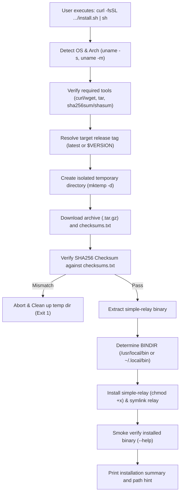

# Standalone One-Line Installation Script (`install.sh`) Design Specification

- **Target Issue:** [#92](https://github.com/simple-relay/simple-relay/issues/92)
- **Author:** `phuong`
- **Date:** 2026-10-24
- **Status:** Approved

---

## 1. Intent & Context

### 1.1 The "Why"
Simple Relay's core philosophy is "One binary. No infrastructure. Reliable HTTP delivery." Currently, running Simple Relay requires either:
1. Docker container runtime (`docker run ghcr.io/simple-relay/simple-relay:latest`).
2. Building from source via Go toolchain (`git clone ... && CGO_ENABLED=0 go build ...`).

In production environments (e.g. lightweight VPS, edge servers, developer machines, or CI runners), users frequently want to download and run the precompiled static binary directly without installing Docker or Go.

Providing a trusted, POSIX-compliant `curl | sh` script allows users to install Simple Relay in seconds:
```bash
curl -fsSL https://raw.githubusercontent.com/simple-relay/simple-relay/main/install.sh | sh
```

---

## 2. Goals, Non-Goals & Anti-Goals

### 2.1 Goals
- **Zero Toolchain Dependencies:** Install the precompiled static binary without Go, Docker, or external package managers.
- **POSIX `/bin/sh` Compliance:** Must work across minimal shell environments (bash, zsh, dash, ash/Alpine) on Linux and macOS.
- **Auto-Detection:** Automatically detect OS (`linux`, `darwin`) and architecture (`amd64`, `arm64`).
- **Cryptographic Integrity:** Download `checksums.txt` and verify SHA256 checksums before unpacking or moving any files into system binary paths.
- **Rate Limit Resilience:** Resolve latest release tags via HTTP redirect (`github.com/.../releases/latest`) instead of the GitHub REST API (`api.github.com`), avoiding rate limits (60 req/hr on unauthenticated IPs).
- **Dual Binary Access:** Install `simple-relay` and create a symbolic link `relay` pointing to `simple-relay`.
- **Target Directory & Symlink Strategy:**
  - Default installation directory: `/usr/local/bin` (elevating with `sudo` if non-root).
  - If `/usr/local/bin` is not writable and `sudo` is absent, automatically fallback to `$HOME/.local/bin`.
  - Allow override via `BINDIR` environment variable.
- **Stateless Post-Install Banner:**
  - Zero disk secret storage (strictly no plaintext `.env` files written to disk).
  - Generate an in-memory 16-character suggested random admin password displayed on stdout for one-off convenience.
  - Display clear, non-intrusive commands to run Simple Relay in loopback dev mode (`relay`) or production mode (`RELAY_ADMIN_PASSWORD="..." relay`).
- **CI Smoke Testing:** Add verification step in GitHub Actions CI to validate `install.sh` against the latest release.

### 2.2 Non-Goals
- **Package Manager Integrations:** Homebrew formulas, APT, or RPM packages are out of scope for this task.
- **Windows Batch / PowerShell:** Windows users use precompiled zip artifacts or Docker; `install.sh` targets Unix-like environments (Linux, macOS, WSL).
- **Systemd Service Installation:** The script installs the binary only; daemon service setup remains an operator responsibility.

### 2.3 Anti-Goals
- **Insecure Execution:** Never execute remote tarballs or binaries without strict checksum verification.
- **Silent Failures:** Never swallow extraction, verification, or permission errors.
- **GitHub API Dependency:** Do not query `api.github.com` without authentication to prevent rate-limiting failures in shared NAT / CI environments.

---

## 3. Technical Design

### 3.1 Architecture & Flow



### 3.2 Detection Matrix

| OS (`uname -s`) | Arch (`uname -m`) | Target Artifact Name |
| :--- | :--- | :--- |
| `Linux` -> `linux` | `x86_64`, `amd64` -> `amd64` | `simple-relay_{version}_linux_amd64.tar.gz` |
| `Linux` -> `linux` | `aarch64`, `arm64` -> `arm64` | `simple-relay_{version}_linux_arm64.tar.gz` |
| `Darwin` -> `darwin` | `x86_64`, `amd64` -> `amd64` | `simple-relay_{version}_darwin_amd64.tar.gz` |
| `Darwin` -> `darwin` | `arm64` -> `arm64` | `simple-relay_{version}_darwin_arm64.tar.gz` |

Any other OS or architecture will abort with an explanatory error message and exit code 1.

### 3.3 GitHub Release URL Resolution

1. **Tag resolution without API rate limit:**
   ```sh
   if [ -z "${VERSION:-}" ] || [ "${VERSION}" = "latest" ]; then
     LATEST_URL="$(curl -sLI -o /dev/null -w '%{url_effective}' https://github.com/simple-relay/simple-relay/releases/latest)"
     TAG="${LATEST_URL##*/}"
   else
     case "$VERSION" in
       v*) TAG="$VERSION" ;;
       *) TAG="v$VERSION" ;;
     esac
   fi
   VERSION_NUM="${TAG#v}"
   ```
2. **Download URLs:**
   - Archive: `https://github.com/simple-relay/simple-relay/releases/download/${TAG}/simple-relay_${VERSION_NUM}_${OS}_${ARCH}.tar.gz`
   - Checksums: `https://github.com/simple-relay/simple-relay/releases/download/${TAG}/checksums.txt`

### 3.4 Checksum Verification Logic

```sh
# Match exact archive filename in checksums.txt
grep "  ${ARCHIVE_NAME}\$" checksums.txt > checksum.expected || \
grep " ${ARCHIVE_NAME}\$" checksums.txt > checksum.expected

if command -v sha256sum >/dev/null 2>&1; then
  sha256sum -c checksum.expected
elif command -v shasum >/dev/null 2>&1; then
  shasum -a 256 -c checksum.expected
elif command -v openssl >/dev/null 2>&1; then
  CALCULATED_HASH="$(openssl dgst -sha256 "${ARCHIVE_NAME}" | awk '{print $NF}')"
  EXPECTED_HASH="$(awk '{print $1}' checksum.expected)"
  [ "$CALCULATED_HASH" = "$EXPECTED_HASH" ]
else
  echo "Error: Neither sha256sum, shasum, nor openssl found." >&2
  exit 1
fi
```

### 3.5 Target Directory & Symlink Strategy

1. **Target Directory (`BINDIR`):**
   - Defaults to `${BINDIR:-/usr/local/bin}`.
   - If user is non-root and `BINDIR` is not writable:
     - Check if `sudo -n true 2>/dev/null` or `sudo` is available.
     - If `sudo` is unavailable or `BINDIR` was explicitly overridden to a non-root path, fallback to `${HOME}/.local/bin`.
2. **Installation & Symlink:**
   - Copy binary to `${BINDIR}/simple-relay` with permissions `0755`.
   - Create symlink: `ln -sf simple-relay "${BINDIR}/relay"`.
3. **PATH Warning:**
   - Check if `${BINDIR}` exists in the user's `${PATH}`.
   - If not, display an actionable instruction: `export PATH="${BINDIR}:\$PATH"`.

---

## 4. Smoke Testing & CI Integration

### 4.1 Local / Standalone Test
A test harness script or test run:
```bash
BINDIR=/tmp/test-install-bin sh install.sh
/tmp/test-install-bin/simple-relay --help
/tmp/test-install-bin/relay --help
[ -L /tmp/test-install-bin/relay ]
```

### 4.2 GitHub Actions CI (`.github/workflows/ci.yml`)
Add a new verification step to the `quality-gate` job:
```yaml
      - name: Verify install.sh script
        run: |
          mkdir -p /tmp/test-bin
          BINDIR=/tmp/test-bin sh install.sh
          /tmp/test-bin/simple-relay --help
          /tmp/test-bin/relay --help
          test -L /tmp/test-bin/relay
```

---

## 5. README Refinement

Update `README.md` under `## Quickstart in 60 Seconds`:
- **Option 1: One-Line Install (Recommended)**
  ```bash
  curl -fsSL https://raw.githubusercontent.com/simple-relay/simple-relay/main/install.sh | sh
  ```
- **Option 2: Run with Docker**
- **Option 3: Build from Source (Pure Go, Zero CGO)**
