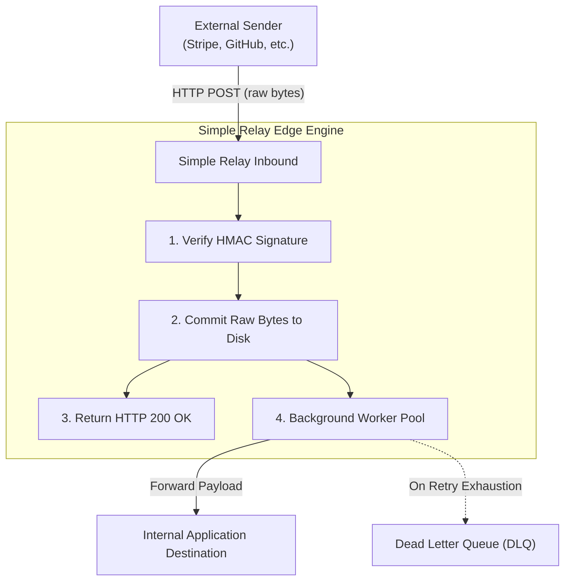

Inbound webhooks are asynchronous push notifications from external third-party services (e.g., Stripe, Shopify, GitHub, Twilio). 

Because external services will often drop notifications or apply severe backoff penalties if your application is restarting, deploying, or undergoing heavy traffic spikes, handling webhooks directly inside application handlers creates significant risk of lost revenue and data inconsistencies.

## The Inbound Webhook Pipeline

Simple Relay operates as an autonomous edge buffer:



---

## 1. The Durability Golden Rule: Persist Before ACK

> **Rule:** Never return HTTP `200 OK` or `202 Accepted` to the sender until the raw, unmodified byte payload is durably committed to storage.

When a webhook arrives at `/api/v1/webhook/:route_name`:
1. The raw payload stream is read into memory buffer.
2. If cryptographic verification is enabled, HMAC signature headers are validated against the raw byte buffer.
3. The raw byte sequence and headers are committed to disk.
4. Only upon successful flush does Simple Relay return `200 OK` with the tracking `request_id`.

If your internal application crashes, restarts, or runs out of database connections 5 seconds later, the webhook is completely safe on disk and will be delivered as soon as your service recovers.

---

## 2. Zero Byte Mutation & Signature Integrity

Many intermediate proxies or API gateways parse incoming JSON payloads into internal object representations and re-serialize them upon forwarding. 

Re-serialization alters whitespace, field order, and unicode escapes, which permanently breaks cryptographic HMAC signatures when downstream applications attempt secondary signature checks.

Simple Relay treats all inbound request bodies as immutable raw byte sequences (`[]byte`). Headers and body bytes forwarded downstream are bit-for-bit identical to what the external sender transmitted.

---

## 3. Configuring Inbound Routes

Inbound routes are registered dynamically via the REST API (`POST /api/v1/routes`) or configured in the embedded Web UI:

```bash
curl -X POST http://localhost:8080/api/v1/routes \
  -H "Content-Type: application/json" \
  -d '{
    "name": "stripe-inbound",
    "type": "inbound",
    "mode": "async",
    "path": "/api/v1/webhook/stripe",
    "destination_url": "http://localhost:3000/api/webhooks/stripe",
    "signature_provider": "stripe",
    "signature_secret": "whsec_...",
    "max_attempts": 10,
    "timeout_ms": 10000,
    "retry_backoff_strategy": "exp",
    "base_backoff_ms": 5000,
    "max_backoff_ms": 900000
  }'
```

When webhooks arrive, Simple Relay verifies the `Stripe-Signature` header, writes to disk, answers Stripe with `200 OK`, and forwards the verified payload to `http://localhost:3000/api/webhooks/stripe`.

---

## 4. Idempotency & Downstream Headers

Simple Relay guarantees **at-least-once delivery**. Transient network dropouts or backend timeouts can cause a delivery to be retried, which means your downstream application must handle duplicate requests safely.

To make idempotency effortless, Simple Relay automatically injects tracking headers into every request forwarded to your backend:

| Header | Example Value | Purpose |
| :--- | :--- | :--- |
| `X-Relay-Request-ID` | `01j9x0m1p00000000000000000` | Monotonic lowercase ULID uniquely identifying the persisted payload. Use this as your primary deduplication key. |
| `X-Relay-Attempt` | `1`, `2`, `3` | Incremental attempt counter. Indicates whether this is the first delivery or a subsequent retry. |
| `Idempotency-Key` | `idem_987123` | Preserved and forwarded downstream if sent by the caller or external webhook provider. |

### Backend Deduplication Pattern

In your downstream handler, simply store `X-Relay-Request-ID` in your database or cache (e.g. Redis `SET NX` or SQL unique constraint):

```javascript
// Express.js / Node.js
app.post('/api/webhooks/stripe', async (req, res) => {
  const relayId = req.headers['x-relay-request-id'];
  const attempt = req.headers['x-relay-attempt'];

  // Check if this delivery was already processed
  const alreadyProcessed = await db.processedWebhooks.findUnique({ where: { id: relayId } });
  if (alreadyProcessed) {
    return res.status(200).json({ status: 'already_processed' });
  }

  await processPayment(req.body);
  await db.processedWebhooks.create({ data: { id: relayId } });

  res.status(200).json({ status: 'success' });
});
```

---

## Next Steps

- Follow the **[Stripe & GitHub Recipe](/docs/stripe-github)** for copy-paste HMAC examples.
- Set up **[Local Webhook Inspection with Cloudflare Tunnel](/docs/local-webhook-inspection)** for local payload debugging and one-click replay.
- Learn about **[Retries and the Dead Letter Queue](/docs/retries-and-dlq)**.
