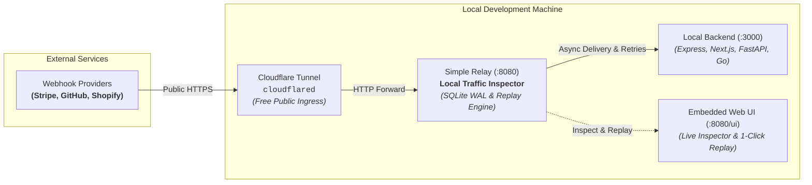

When developing webhook integrations locally, engineers are increasingly migrating from ngrok to **Cloudflare Tunnel (`cloudflared`)**. Cloudflare Tunnel offers a generous, production-grade free tier with stable custom domains, zero bandwidth throttling, and no disruptive interstitial warning pages.

However, once developers make the switch, they immediately encounter a frustrating limitation: **`cloudflared` does not have an interactive request inspector or replay UI** (unlike ngrok's well-known `http://localhost:4040`).

By positioning **Simple Relay** between Cloudflare Tunnel and your local development server (`cloudflared` → Simple Relay → Local App), you unlock a local traffic inspector, crash-resilient webhook ingestion, and one-click request replay—bringing back the best parts of the ngrok developer experience while keeping the speed and freedom of Cloudflare Tunnels.

---

## 1. The Dilemma: Why Developers Miss ngrok's `localhost:4040`

Cloudflare Tunnel is engineered purely as a fast, secure network tunnel between the edge and your machine. It pipes raw TCP/HTTP streams directly to your local application port and intentionally maintains zero local state or request logs.

During active webhook development, this creates three major developer pain points:

1. **No Visual Traffic Inspector:** You cannot inspect incoming HTTP headers, cryptographic HMAC signatures (`Stripe-Signature`, `X-Hub-Signature-256`), or payload JSON without polluting application code with debug middleware or temporary `console.log` statements.
2. **No One-Click Replay:** When testing a bug fix or edge case in your local webhook handler, you are forced to re-trigger test events manually inside external vendor dashboards (such as re-running a dummy checkout session in Stripe or pushing commits to GitHub).
3. **Dropped Webhooks During Server Restarts:** When your local server hot-reloads (e.g., via `nodemon`, `cargo watch`, or `go run`), any incoming webhook delivered by the tunnel is immediately rejected with `connection refused`. The external vendor flags your endpoint as failing and applies exponential backoff penalties.

### Feature Comparison Matrix

| Capability | Cloudflare Tunnel Alone | ngrok (Free Tier) | Cloudflare Tunnel + Simple Relay |
| :--- | :---: | :---: | :---: |
| **Stable Custom URLs** | Free | Paid ($8+/mo) | **Free** (via Cloudflare) |
| **Zero Interstitial Warning Pages** | Yes | No (Free tier warning) | **Yes** |
| **Visual Webhook Inspector UI** | No | Yes (`localhost:4040`) | **Yes (`localhost:8080/ui`)** |
| **One-Click Request Replay** | No | Yes | **Yes (UI & CLI)** |
| **Replay Any Historical Request (including 200 OK)** | No | No (DLQ/failures only) | **Yes (success, failed, dlq)** |
| **Zero-Loss During Server Restarts** | No (Connection refused) | No (Connection refused) | **Yes (SQLite WAL buffering)** |
| **Preserves Cryptographic Signatures** | Yes | Yes | **Yes (Zero-byte mutation)** |
| **Cost** | 100% Free | Freemium / Paid | **100% Free & Open Source** |

---

## 2. Traffic Architecture



### How the Pipeline Works:
1. **Public Ingress:** Cloudflare Tunnel forwards public webhook requests to Simple Relay on port `8080`.
2. **Durable Ingestion:** Simple Relay commits the unmodified payload and headers to local SQLite WAL storage and immediately returns HTTP `200 OK` to Cloudflare Tunnel.
3. **Background Delivery:** Simple Relay dispatches the payload to your local backend server on port `3000`.
4. **Inspection & Replay:** You inspect headers and payloads at `http://localhost:8080/ui` and replay requests on demand with one click.

---

## 3. Step-by-Step Setup Guide

### Step 1: Start Simple Relay Locally

Simple Relay ships as a single static binary with no external infrastructure requirements:

```bash
# Run the binary locally
relay

# Or run with Docker (GHCR)
docker run -d --name relay -p 8080:8080 ghcr.io/simple-relay/simple-relay:latest
```

> [!TIP] Alternative Installation Methods
> For other installation options including standalone binary releases, `go install`, and Docker Compose setups with persistent storage, see the [Getting Started / Quickstart Guide](/docs/quickstart).

Open `http://localhost:8080/ui` in your browser. The embedded dashboard loads instantly with zero build steps or frontend servers.

### Step 2: Configure a Local Inbound Route

In the Web UI, navigate to the **Routes** tab, click **New Route**, and configure an asynchronous webhook route pointing to your local app:

| Parameter | Recommended Value | Explanation |
| :--- | :--- | :--- |
| **Route Name** | `local-webhooks` | Route slug used in the tunnel URL. |
| **Type** | `inbound` | Ingests webhooks and persists payloads before delivery. |
| **Delivery Mode** | `async` | Instantly acknowledges receipt, delivers in the background. |
| **Inbound Path** | `/api/v1/webhook/local-webhooks` | The path exposed to Cloudflare Tunnel. |
| **Destination URL** | `http://127.0.0.1:3000/api/webhooks` | Your local backend port and endpoint path. |
| **Max Attempts** | `5` | Buffers and retries deliveries if your local server restarts. |

*(Optional)* You can also provision the route directly via the REST API or CLI:

```bash
curl -X POST http://localhost:8080/api/v1/routes \
  -H "Content-Type: application/json" \
  -d '{
    "name": "local-webhooks",
    "type": "inbound",
    "mode": "async",
    "path": "/api/v1/webhook/local-webhooks",
    "destination_url": "http://127.0.0.1:3000/api/webhooks",
    "max_attempts": 5,
    "timeout_ms": 5000
  }'
```

### Step 3: Start Cloudflare Tunnel

Run `cloudflared` pointing to Simple Relay's port (`8080`):

```bash
cloudflared tunnel --url http://127.0.0.1:8080
```

Cloudflare will provide a public URL (e.g., `https://example-tunnel.trycloudflare.com`).

### Step 4: Configure Your Webhook Provider

In your webhook provider's dashboard (e.g., Stripe Dashboard → Developers → Webhooks), register your public endpoint:

```text
https://example-tunnel.trycloudflare.com/api/v1/webhook/local-webhooks
```

---

## 4. Webhook Traffic Inspection Workflow

Whenever a webhook triggers, open `http://localhost:8080/ui` and navigate to the **Requests** tab:

1. **Chronological Delivery Audit:** View real-time request entries with method, route name, status (`success`, `pending`, `processing`, `failed`, `dlq`), attempt counts, and timestamp.
2. **Deep Slide-Over Inspection Drawer:** Click any row or the **Inspect →** button to inspect:
   - **Cryptographic Headers:** Verify headers such as `Stripe-Signature`, `X-Hub-Signature-256`, or custom authentication tokens.
   - **Raw Body Payload:** Inspect unmodified JSON or binary payload bytes formatted with syntax highlighting.
   - **One-Click cURL Export:** Click **Copy as cURL** to copy the exact incoming request—with all original headers and body bytes preserved—for testing in terminal or Postman.
   - **Attempt Audit Log:** Review downstream response status codes, execution duration in milliseconds, and error messages returned by your local backend.

---

## 5. Replaying Webhooks: The Instant Debugging Loop

Traditional webhook debugging is tedious: every time you fix a bug in your handler, you have to trigger another event in the SaaS provider's dashboard.

Simple Relay allows you to replay **any historical request**, including requests that previously completed with `success` (`200 OK`).

### One-Click Replay in the Web UI
- **From the Requests Table:** Click the **Replay** button on any table row.
- **From the Inspection Drawer:** Click the **Replay** button in the header drawer while viewing payload details.

The request immediately transitions back to `pending`, attempts reset to 0, and Simple Relay's dispatcher wakes up instantly to re-fire the webhook to your local app.

### Terminal Replay via CLI
If you prefer staying in your terminal or want to script replays, use the embedded CLI:

```bash
# Replay any request by ID
relay request replay 01j9y9success001

# Replay using JSON output for shell pipelines
relay request replay 01j9y9success001 -o json
```

---

## 6. Zero-Loss Server Restarts

When developing locally with hot-reloading tools (`nodemon`, `cargo watch`, `air`, `go run`), your local application restarts every time you save a file.

If a webhook arrives during those few seconds of downtime:
- **Without Simple Relay:** Cloudflare Tunnel tries to connect to `127.0.0.1:3000`, receives `ECONNREFUSED`, and returns `502 Bad Gateway` to Stripe or GitHub. The provider registers a delivery failure.
- **With Simple Relay:** Cloudflare Tunnel delivers to Simple Relay on `127.0.0.1:8080`. Simple Relay writes the raw payload to SQLite WAL and returns `200 OK` to the provider. Simple Relay's worker pool attempts delivery, detects that the local app is rebooting, and schedules an automatic backoff retry. As soon as your server is back online, the webhook is delivered without a single dropped packet.
