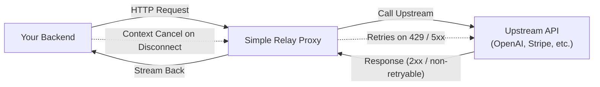
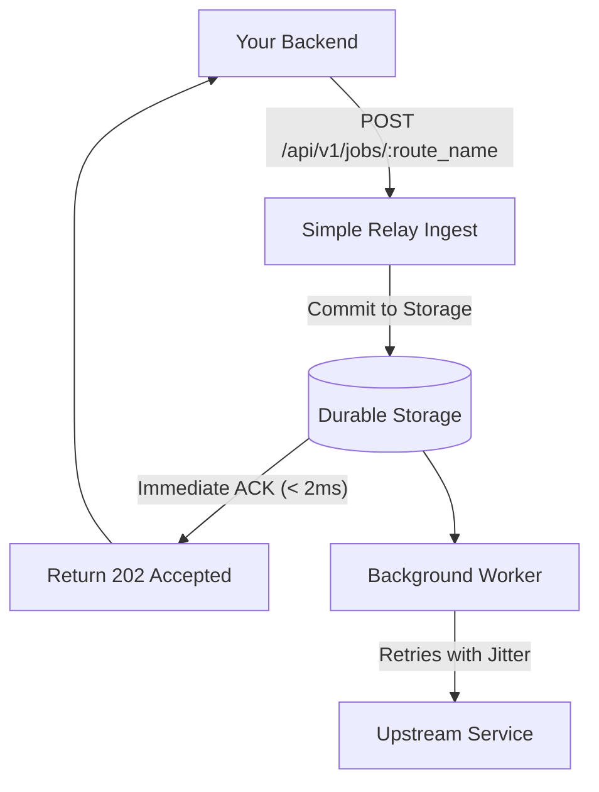

Simple Relay provides two operational modes for handling outgoing HTTP requests to external third-party APIs and downstream services:

1. **Synchronous Transparent Proxy (`/api/v1/relay/:route_name`)**
2. **Asynchronous Background Jobs (`/api/v1/jobs/:route_name`)**

> [!NOTE] Outbound Endpoint Authentication & Credential Stripping
> Both `/api/v1/relay/:route_name` and `/api/v1/jobs/:route_name` are **protected endpoints**. Callers must authenticate with a valid API key (`X-API-Key: sr_live_...` or `Authorization: Bearer sr_live_...`), unless connecting from a local loopback socket (`127.0.0.1` / `::1`) in Dev Mode (`RELAY_ADMIN_PASSWORD=""`). Simple Relay automatically strips its own authentication credentials (`X-API-Key`, `Authorization: Bearer sr_live_*`, and `relay_session` cookie) before persisting request logs or forwarding headers to your upstream destination, while preserving any upstream `Authorization` header (such as `Authorization: Bearer $OPENAI_API_KEY`).

---

## 1. Synchronous Transparent Proxy

Use the synchronous proxy when your application makes an outbound request to an external service and needs the response immediately to complete the current HTTP lifecycle, but wants resilience against transient network blips and rate limits.

### Request Flow



### Usage Example

```bash
curl -X POST "http://localhost:8080/api/v1/relay/stripe-charges" \
  -H "X-API-Key: sr_live_..." \
  -H "Idempotency-Key: order_12345" \
  -H "Content-Type: application/json" \
  -d '{"amount": 2000, "customer": "cus_123"}'
```

### Automatic 429 & 5xx Retries with `Retry-After` & Idempotency Guardrails

When upstream responds with:
- `429 Too Many Requests`
- `500 Internal Server Error`, `502 Bad Gateway`, `503 Service Unavailable`, `504 Gateway Timeout`

Simple Relay intercepts the status code, inspects `Retry-After` headers (both integer seconds and RFC1123 HTTP dates), applies uniform full jitter (`100ms` base, `10s` max by default, or route `base_backoff_ms` / `max_backoff_ms`), and retries the upstream request. Once upstream responds with `2xx` or non-retryable `4xx`, Simple Relay streams the response directly back to the caller.

> [!IMPORTANT] Safe-by-Default Non-Idempotent Sync Retries
> To prevent duplicate charges or unintended side effects when an upstream times out after committing a transaction:
> - **Idempotent HTTP methods** (`GET`, `HEAD`, `PUT`, `DELETE`, `OPTIONS`, `TRACE`) are always retried up to `max_attempts`.
> - **Non-idempotent HTTP methods** (`POST`, `PATCH`) are only retried on `/api/v1/relay/:route_name` if the caller supplies an `Idempotency-Key` (or `X-Relay-Idempotency-Key`) header, **OR** the route explicitly enables `"retry_non_idempotent": true`. Otherwise, Simple Relay executes a single attempt (`maxAttempts = 1`) and returns the upstream result immediately.

### Client Disconnect Cancellation (Zero Wasted Compute)

> **Critical Safety Mechanism:** If your calling client closes its TCP connection, times out, or navigates away before Simple Relay finishes proxying, Simple Relay immediately triggers a Go context cancellation (`r.Context()`).

In-flight upstream requests are aborted instantaneously, and any scheduled retries are canceled. This prevents:
- Burning external API quotas when users have already left the page.
- Accumulating orphan worker goroutines during traffic spikes.

---

## 2. Asynchronous Background Jobs

Use the asynchronous mode for fire-and-forget requests (sending emails, audit logs, analytics events, telemetry).

### Request Flow



### Usage Example

```bash
curl -X POST "http://localhost:8080/api/v1/jobs/resend-emails" \
  -H "X-API-Key: sr_live_..." \
  -H "Content-Type: application/json" \
  -d '{"from": "noreply@app.com", "to": "user@gmail.com", "subject": "Welcome!"}'
```

Response:
```http
HTTP/1.1 202 Accepted
Content-Type: application/json

{"job_id":"01j9x0z87q00000000000000000","status":"queued"}
```

The request returns in under 2 milliseconds. The payload is guaranteed to be delivered at-least-once according to your configured retry and backoff policy.

---

## Next Steps

- Explore how **[Retries and the Dead Letter Queue](/docs/retries-and-dlq)** handle persistent upstream outages.
- Read the **[Rate Limits and 429 Recipe](/docs/rate-limits-429)**.
