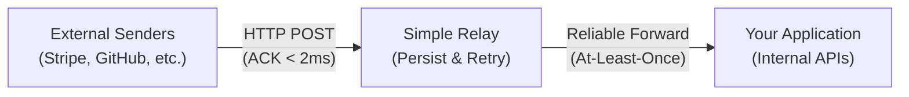

## What is Simple Relay?

**Simple Relay** is a lightweight, self-hosted reliability layer for HTTP traffic. It acts as an autonomous buffer and proxy between external services and your internal backend.

Building reliable webhook ingestion and outbound API retries usually forces engineering teams to assemble heavy distributed infrastructure: message brokers, external caching tiers, worker processes, and separate databases.

Simple Relay eliminates that operational tax: **one single binary, zero infrastructure friction, reliable HTTP delivery.**

---

## The Core Pillars of Simple Relay

Simple Relay is engineered around three mission-critical guarantees:

### 1. Zero Data Loss (Persist Before ACK)
In-memory queues and background threads inside your application runtime disappear whenever processes restart, deploy, or crash. External webhook providers (such as Stripe, Shopify, or GitHub) may back off for hours or drop deliveries entirely if your server blips.

Simple Relay strictly enforces **Persist-Before-ACK**: raw incoming byte payloads and headers are flushed to durable, crash-resilient local storage *before* returning HTTP `200 OK` to the sender. Once acknowledged, delivery to your backend is guaranteed.

### 2. Ultra-Fast Inbound ACK Response Time (< 2ms)
External webhook providers impose aggressive response timeouts—often between 2 and 5 seconds. If your application attempts to execute database transactions, trigger analytics, or send emails synchronously inside the webhook handler, sudden load spikes will cause upstream timeouts. When timeouts occur, external providers flag your endpoint as failing and will automatically disable your webhooks.

Simple Relay decouples **ingestion acknowledgement** from **downstream execution**:
- Ingests the payload, validates cryptographic HMAC signatures, commits to durable storage, and answers the sender with `200 OK` in **under 2 milliseconds**.
- External senders immediately see a 100% healthy, lightning-fast endpoint.
- Simple Relay's background workers then forward payloads to your application at a safe, controlled pace.

### 3. Dead-Simple Deployment (One Self-Contained Binary)
Reliability shouldn't require managing an entire operations cluster. Simple Relay has zero external service dependencies—no separate databases to provision, no message brokers to monitor, and no complex queue workers to scale. 

Run it as a single binary on a Linux virtual machine or as a lightweight Docker container. It manages its own durable persistence, background worker pools, retry schedulers, and embedded management UI out of the box.

### 4. Client-Abort Aware Outbound Proxy
Standard reverse proxies continue blasting requests to external APIs even after the caller has disconnected. Simple Relay's synchronous proxy listens to incoming client connection state. If a client terminates the connection or times out, in-flight upstream requests and subsequent retry loops abort immediately to prevent wasted compute and upstream API rate limit exhaustion.

---

## High-Level Capabilities

| Capability | The Challenge | How Simple Relay Solves It |
| :--- | :--- | :--- |
| **Zero Data Loss** | Application restarts and deploy cycles drop in-flight requests. | Commits raw bytes to durable storage before returning `200 OK`. |
| **Ultra-Fast Inbound ACK** | Downstream processing causes timeouts from Stripe, Shopify, GitHub. | Decouples ingestion from execution; responds in `< 2ms`. |
| **Dead-Simple Deployment** | Message queues and worker clusters create heavy maintenance overhead. | Single self-contained binary with zero external services required. |
| **Smart Outbound Retries** | API rate limits (`429`) and server errors (`5xx`) disrupt operations. | Automatic retries with exponential backoff and randomized full jitter. |
| **Client Disconnect Awareness** | Dropped client requests waste third-party API quotas. | Aborts in-flight upstream requests immediately when callers drop. |
| **Dead Letter Queue (DLQ)** | Exhausted retries vanish into server error logs. | Failed deliveries are safely preserved in the DLQ for one-click replay. |
| **Embedded Web UI** | Monitoring queue state requires setting up third-party dashboards. | Built-in browser UI with zero Node.js build pipeline or server processes. |

---

## Next Steps

- Jump straight into the **[Quickstart](/docs/quickstart)** to launch your first relay.
- Learn about the **[Inbound Webhook Pipeline](/docs/inbound-webhooks)** and HMAC verification.
- Explore **[Outbound Proxying & Retries](/docs/outbound-proxy)**.
